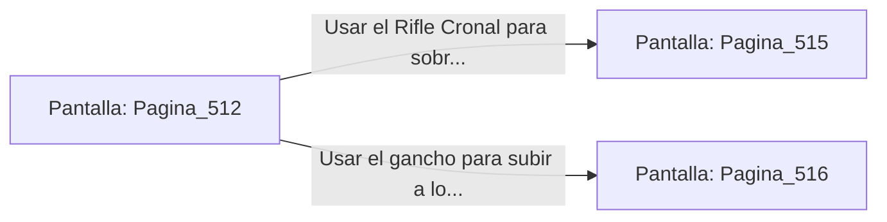

# 📺 Nodo Pantalla: `Pagina_512`

[[Index|⬅️ Índice]] | Fichero Origen: [[sample_eligejuego-code_capitulo_27_mpl|📄 sample/eligejuego-code/capitulo_27.mpl]]

**Narrativa y Encabezado:**
> PÁGINA 512: LA PASARELA DE LAS CÚPULAS
> 
> Avanzas con cautela sobre las losas cristalinas que revelan el vacío abisal bajo tus pies. La vibración de la energía del Núcleo hace resonar las placas de tu armadura mientras los relámpagos de luz esmeralda se reflejan en la visera de tu casco.
> 
> A mitad de la pasarela, dos Guardianes de Fase Primordiales bajan sus albardas refractarias y despliegan un muro de plasma para cortar tu avance.

## 📋 Desglose de Instrucciones de Opciones
### `OPCION "Usar el Rifle Cronal para sobrecargar el núcleo de los dos guardianes" CON_ACCION TRANSICIONAR_A Pagina_515`
* **Instrucción:** `OPCION` *(Manual: Mapea una entrada o botón interactivo de usuario. Vincular una acción como la invocación de una función C1, un método C2 o una transición C3.)*
* **Efecto de Control:** Dispara `TRANSICIONAR_A` hacia [[Pantalla_Pagina_515|📺 Pagina_515]]
### `OPCION "Usar el gancho para subir a los anillos de contención superiores" CON_ACCION TRANSICIONAR_A Pagina_516`
* **Instrucción:** `OPCION` *(Manual: Mapea una entrada o botón interactivo de usuario. Vincular una acción como la invocación de una función C1, un método C2 o una transición C3.)*
* **Efecto de Control:** Dispara `TRANSICIONAR_A` hacia [[Pantalla_Pagina_516|📺 Pagina_516]]

## 📊 Diagrama de Flujo e Interacción (Mermaid)

