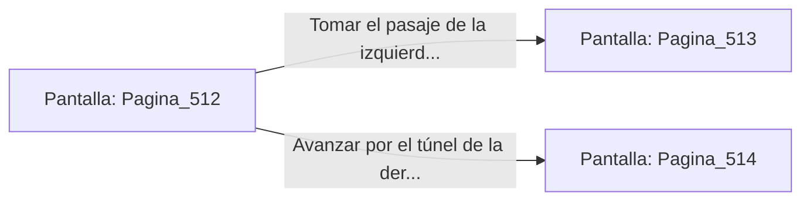

# 📺 Nodo Pantalla: `Pagina_512`

[[Index|⬅️ Índice]] | Fichero Origen: [[sample_eligejuego-code_capitulo_09_camara_talisman_mpl|📄 sample/eligejuego-code/capitulo_09_camara_talisman.mpl]]

**Narrativa y Encabezado:**
> Página 512: La Cámara del Talismán
> 
> La magia en esta sala es tan densa que cuesta respirar. En el centro brilla la reliquia sagrada. Te encuentras ante una encrucijada en la penumbra de la mazmorra. Debes tomar una decisión.

## 📋 Desglose de Instrucciones de Opciones
### `OPCION "Tomar el pasaje de la izquierda (Página 513)" CON_ACCION TRANSICIONAR_A Pagina_513`
* **Instrucción:** `OPCION` *(Manual: Mapea una entrada o botón interactivo de usuario. Vincular una acción como la invocación de una función C1, un método C2 o una transición C3.)*
* **Efecto de Control:** Dispara `TRANSICIONAR_A` hacia [[Pantalla_Pagina_513|📺 Pagina_513]]
### `OPCION "Avanzar por el túnel de la derecha (Página 514)" CON_ACCION TRANSICIONAR_A Pagina_514`
* **Instrucción:** `OPCION` *(Manual: Mapea una entrada o botón interactivo de usuario. Vincular una acción como la invocación de una función C1, un método C2 o una transición C3.)*
* **Efecto de Control:** Dispara `TRANSICIONAR_A` hacia [[Pantalla_Pagina_514|📺 Pagina_514]]

## 📊 Diagrama de Flujo e Interacción (Mermaid)

