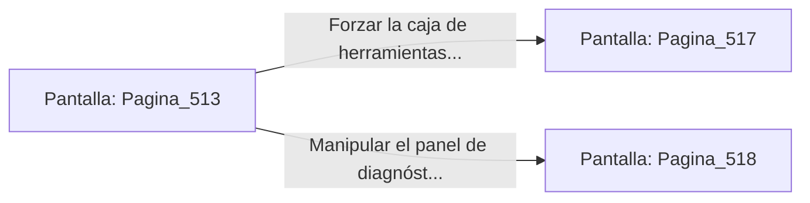

# 📺 Nodo Pantalla: `Pagina_513`

[[Index|⬅️ Índice]] | Fichero Origen: [[sample_eligejuego-code_capitulo_27_mpl|📄 sample/eligejuego-code/capitulo_27.mpl]]

**Narrativa y Encabezado:**
> PÁGINA 513: EL TÚNEL DE PURGA DE FLUJO
> 
> Te introduces en el angosto túnel de piedra refractaria por el que discurren las tuberías de retorno de éter helado. La temperatura ambiente cae bruscamente bajo cero, cubriendo de escarcha los circuitos exteriores de tu equipo.
> 
> Tras superar la primera curva, alcanzas una cámara de control secundario donde sobre una consola de teca descansa una caja de herramientas blindada y un panel de diagnóstico activo.
> 
> Tienes la opción de forzar la caja para recuperar suministros curativos o manipular el panel para alterar la presión de flujo del túnel.

## 📋 Desglose de Instrucciones de Opciones
### `OPCION "Forzar la caja de herramientas blindada para recuperar suministros" CON_ACCION TRANSICIONAR_A Pagina_517`
* **Instrucción:** `OPCION` *(Manual: Mapea una entrada o botón interactivo de usuario. Vincular una acción como la invocación de una función C1, un método C2 o una transición C3.)*
* **Efecto de Control:** Dispara `TRANSICIONAR_A` hacia [[Pantalla_Pagina_517|📺 Pagina_517]]
### `OPCION "Manipular el panel de diagnóstico para alterar la presión de flujo" CON_ACCION TRANSICIONAR_A Pagina_518`
* **Instrucción:** `OPCION` *(Manual: Mapea una entrada o botón interactivo de usuario. Vincular una acción como la invocación de una función C1, un método C2 o una transición C3.)*
* **Efecto de Control:** Dispara `TRANSICIONAR_A` hacia [[Pantalla_Pagina_518|📺 Pagina_518]]

## 📊 Diagrama de Flujo e Interacción (Mermaid)

