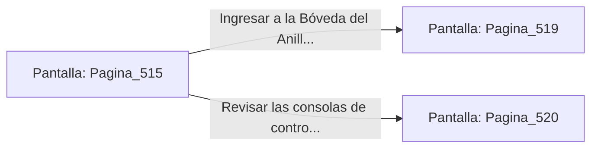

# 📺 Nodo Pantalla: `Pagina_515`

[[Index|⬅️ Índice]] | Fichero Origen: [[sample_eligejuego-code_capitulo_27_mpl|📄 sample/eligejuego-code/capitulo_27.mpl]]

**Narrativa y Encabezado:**
> PÁGINA 515: SOBRECARGA EN LA PASARELA
> 
> Alineas la mira del Rifle Cronal y descargas dos ráfagas de aceleración concentrada contra las juntas de los escudos de inducción. Los proyectiles penetran la barrera cuántica y sobrecargan los condensadores de los Guardianes de Fase, haciéndolos estallar en una llamarada de luz dorada.
> 
> Con la pasarela libre, alcanzas el descansillo donde un armario de repuesto permanece entreabierto. En su interior hallas dos Células de Éter Sobrecargadas y la Tarjeta de Acceso a la Bóveda del Anillo Maestro.
> 
> Guardas los componentes en tu arnés antes de dirigirte a la puerta acorazada del Anillo Maestro.

## 📋 Desglose de Instrucciones de Opciones
### `OPCION "Ingresar a la Bóveda del Anillo Maestro con la tarjeta de acceso" CON_ACCION TRANSICIONAR_A Pagina_519`
* **Instrucción:** `OPCION` *(Manual: Mapea una entrada o botón interactivo de usuario. Vincular una acción como la invocación de una función C1, un método C2 o una transición C3.)*
* **Efecto de Control:** Dispara `TRANSICIONAR_A` hacia [[Pantalla_Pagina_519|📺 Pagina_519]]
### `OPCION "Revisar las consolas de control del descansillo" CON_ACCION TRANSICIONAR_A Pagina_520`
* **Instrucción:** `OPCION` *(Manual: Mapea una entrada o botón interactivo de usuario. Vincular una acción como la invocación de una función C1, un método C2 o una transición C3.)*
* **Efecto de Control:** Dispara `TRANSICIONAR_A` hacia [[Pantalla_Pagina_520|📺 Pagina_520]]

## 📊 Diagrama de Flujo e Interacción (Mermaid)

