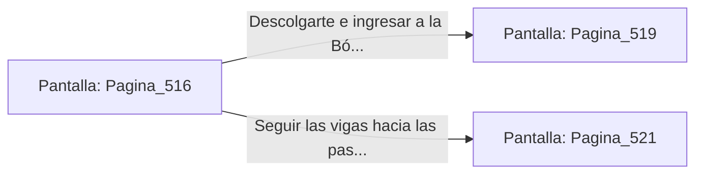

# 📺 Nodo Pantalla: `Pagina_516`

[[Index|⬅️ Índice]] | Fichero Origen: [[sample_eligejuego-code_capitulo_27_mpl|📄 sample/eligejuego-code/capitulo_27.mpl]]

**Narrativa y Encabezado:**
> PÁGINA 516: EVASIÓN POR LOS ANILLOS SUPERIORES
> 
> Disparas tu gancho y te elevas hacia los anillos de contención que giran sobre la pasarela, dejando abajo al muro de plasma. Avanzas mano sobre mano por la estructura de titanio hasta superar la barrera defensiva.
> 
> Te descuelgas limpiamente al otro lado del corredor frente al portón de acceso.

## 📋 Desglose de Instrucciones de Opciones
### `OPCION "Descolgarte e ingresar a la Bóveda del Anillo Maestro" CON_ACCION TRANSICIONAR_A Pagina_519`
* **Instrucción:** `OPCION` *(Manual: Mapea una entrada o botón interactivo de usuario. Vincular una acción como la invocación de una función C1, un método C2 o una transición C3.)*
* **Efecto de Control:** Dispara `TRANSICIONAR_A` hacia [[Pantalla_Pagina_519|📺 Pagina_519]]
### `OPCION "Seguir las vigas hacia las pasarelas de diagnóstico" CON_ACCION TRANSICIONAR_A Pagina_521`
* **Instrucción:** `OPCION` *(Manual: Mapea una entrada o botón interactivo de usuario. Vincular una acción como la invocación de una función C1, un método C2 o una transición C3.)*
* **Efecto de Control:** Dispara `TRANSICIONAR_A` hacia [[Pantalla_Pagina_521|📺 Pagina_521]]

## 📊 Diagrama de Flujo e Interacción (Mermaid)

