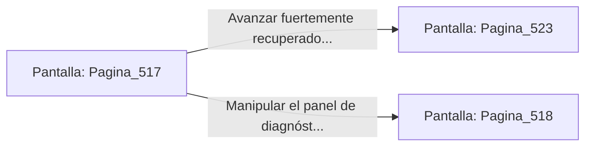

# 📺 Nodo Pantalla: `Pagina_517`

[[Index|⬅️ Índice]] | Fichero Origen: [[sample_eligejuego-code_capitulo_27_mpl|📄 sample/eligejuego-code/capitulo_27.mpl]]

**Narrativa y Encabezado:**
> PÁGINA 517: RECOLECCIÓN DE TÓNICOS DEL ANILLO
> 
> Fuerzas la cerradura de la caja de herramientas con la estaca rúnica de tu Brazal. La tapa se abre revelando dos viales de Suero Reconstituyente y una bomba de pulso electromagnético concentrado.
> 
> Consumes uno de los viales, sintiendo cómo una agradable ola de calor curativo reconforta tus tejidos congelados y restaura por completo tu salud máxima.
> 
> Sillas el segundo vial en tu cinturón táctico antes de continuar hacia la Cámara de Control del Flujo.

## 📋 Desglose de Instrucciones de Opciones
### `OPCION "Avanzar fuertemente recuperado hacia la Cámara de Control del Flujo" CON_ACCION TRANSICIONAR_A Pagina_523`
* **Instrucción:** `OPCION` *(Manual: Mapea una entrada o botón interactivo de usuario. Vincular una acción como la invocación de una función C1, un método C2 o una transición C3.)*
* **Efecto de Control:** Dispara `TRANSICIONAR_A` hacia [[Pantalla_Pagina_523|📺 Pagina_523]]
### `OPCION "Manipular el panel de diagnóstico antes de marcharte" CON_ACCION TRANSICIONAR_A Pagina_518`
* **Instrucción:** `OPCION` *(Manual: Mapea una entrada o botón interactivo de usuario. Vincular una acción como la invocación de una función C1, un método C2 o una transición C3.)*
* **Efecto de Control:** Dispara `TRANSICIONAR_A` hacia [[Pantalla_Pagina_518|📺 Pagina_518]]

## 📊 Diagrama de Flujo e Interacción (Mermaid)

