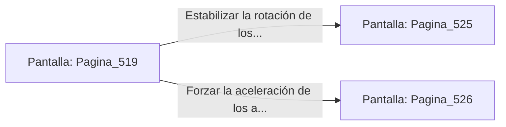

# 📺 Nodo Pantalla: `Pagina_519`

[[Index|⬅️ Índice]] | Fichero Origen: [[sample_eligejuego-code_capitulo_27_mpl|📄 sample/eligejuego-code/capitulo_27.mpl]]

**Narrativa y Encabezado:**
> PÁGINA 519: LA BÓVEDA DEL ANILLO MAESTRO
> 
> Deslizas la tarjeta de acceso por el lector rúnico e ingresas a la monumental Bóveda del Anillo Maestro. Anillos concéntricos de oro y titanio giran en torno al conmutador central, regulando el flujo de poder hacia todas las estancias del complejo.
> 
> En la consola principal brilla la Tarjeta de Nivel Diez y un conmutador que permite estabilizar la rotación o forzar la aceleración de los anillos.
> 
> Sincronizas la Tarjeta de Nivel Diez en tu Brazal de Convergencia antes de operar los mandos de la consola.

## 📋 Desglose de Instrucciones de Opciones
### `OPCION "Estabilizar la rotación de los anillos en la consola central" CON_ACCION TRANSICIONAR_A Pagina_525`
* **Instrucción:** `OPCION` *(Manual: Mapea una entrada o botón interactivo de usuario. Vincular una acción como la invocación de una función C1, un método C2 o una transición C3.)*
* **Efecto de Control:** Dispara `TRANSICIONAR_A` hacia [[Pantalla_Pagina_525|📺 Pagina_525]]
### `OPCION "Forzar la aceleración de los anillos para sobrecargar las torretas" CON_ACCION TRANSICIONAR_A Pagina_526`
* **Instrucción:** `OPCION` *(Manual: Mapea una entrada o botón interactivo de usuario. Vincular una acción como la invocación de una función C1, un método C2 o una transición C3.)*
* **Efecto de Control:** Dispara `TRANSICIONAR_A` hacia [[Pantalla_Pagina_526|📺 Pagina_526]]

## 📊 Diagrama de Flujo e Interacción (Mermaid)

