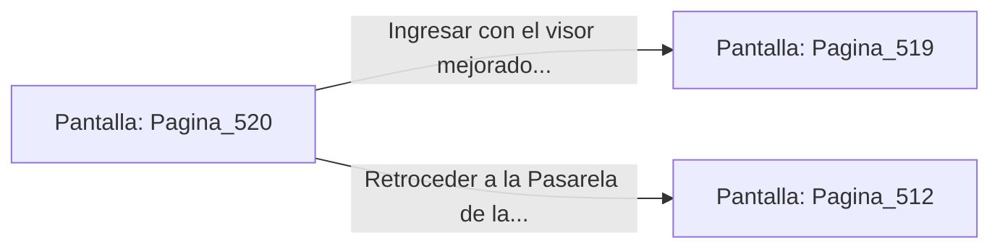

# 📺 Nodo Pantalla: `Pagina_520`

[[Index|⬅️ Índice]] | Fichero Origen: [[sample_eligejuego-code_capitulo_27_mpl|📄 sample/eligejuego-code/capitulo_27.mpl]]

**Narrativa y Encabezado:**
> PÁGINA 520: REVISIÓN DE CONSOLAS DEL DESCANSILLO
> 
> Examinas las consolas de control del descansillo y recuperas un visor de enfoque mnemónico de alta frecuencia que adosas a tu casco.
> 
> Con la mejora lista, ingresas a la Bóveda del Anillo Maestro.

## 📋 Desglose de Instrucciones de Opciones
### `OPCION "Ingresar con el visor mejorado a la Bóveda del Anillo Maestro" CON_ACCION TRANSICIONAR_A Pagina_519`
* **Instrucción:** `OPCION` *(Manual: Mapea una entrada o botón interactivo de usuario. Vincular una acción como la invocación de una función C1, un método C2 o una transición C3.)*
* **Efecto de Control:** Dispara `TRANSICIONAR_A` hacia [[Pantalla_Pagina_519|📺 Pagina_519]]
### `OPCION "Retroceder a la Pasarela de las Cúpulas" CON_ACCION TRANSICIONAR_A Pagina_512`
* **Instrucción:** `OPCION` *(Manual: Mapea una entrada o botón interactivo de usuario. Vincular una acción como la invocación de una función C1, un método C2 o una transición C3.)*
* **Efecto de Control:** Dispara `TRANSICIONAR_A` hacia [[Pantalla_Pagina_512|📺 Pagina_512]]

## 📊 Diagrama de Flujo e Interacción (Mermaid)

