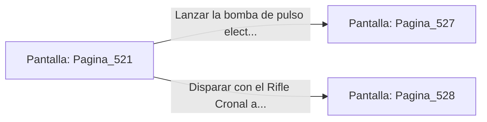

# 📺 Nodo Pantalla: `Pagina_521`

[[Index|⬅️ Índice]] | Fichero Origen: [[sample_eligejuego-code_capitulo_27_mpl|📄 sample/eligejuego-code/capitulo_27.mpl]]

**Narrativa y Encabezado:**
> PÁGINA 521: LAS PASARELAS DE DIAGNÓSTICO
> 
> Te descuelgas a las pasarelas de diagnóstico del Anillo Interior. Pantallas holográficas muestran lecturas en tiempo real sobre la estabilidad de las 600 Cámaras del Cronoclave.
> 
> Un autómata pesado de combate de la guardia personal custodia la consola de alineación esgrimiendo un cañón de plasma. La unidad te fija e inicia la secuencia de erradicación.
> 
> Puedes usar tu bomba de pulso electromagnético para anular sus sistemas o disparar con tu Rifle Cronal al tubo de ventilación de su cañón.

## 📋 Desglose de Instrucciones de Opciones
### `OPCION "Lanzar la bomba de pulso electromagnético contra el autómata pesado" CON_ACCION TRANSICIONAR_A Pagina_527`
* **Instrucción:** `OPCION` *(Manual: Mapea una entrada o botón interactivo de usuario. Vincular una acción como la invocación de una función C1, un método C2 o una transición C3.)*
* **Efecto de Control:** Dispara `TRANSICIONAR_A` hacia [[Pantalla_Pagina_527|📺 Pagina_527]]
### `OPCION "Disparar con el Rifle Cronal al tubo de ventilación de su cañón" CON_ACCION TRANSICIONAR_A Pagina_528`
* **Instrucción:** `OPCION` *(Manual: Mapea una entrada o botón interactivo de usuario. Vincular una acción como la invocación de una función C1, un método C2 o una transición C3.)*
* **Efecto de Control:** Dispara `TRANSICIONAR_A` hacia [[Pantalla_Pagina_528|📺 Pagina_528]]

## 📊 Diagrama de Flujo e Interacción (Mermaid)

