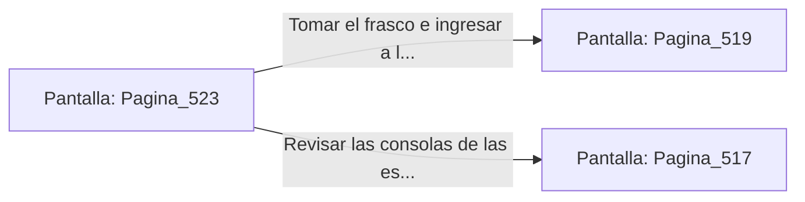

# 📺 Nodo Pantalla: `Pagina_523`

[[Index|⬅️ Índice]] | Fichero Origen: [[sample_eligejuego-code_capitulo_27_mpl|📄 sample/eligejuego-code/capitulo_27.mpl]]

**Narrativa y Encabezado:**
> PÁGINA 523: LA CÁMARA DE CONTROL DEL FLUJO
> 
> Ingresas a la Cámara de Control del Flujo. Grandes esferas de cristal translúcido canalizan el éter líquido hacia la columna del Núcleo, emitiendo un zumbido armónico constante.
> 
> En la peana central reposa un frasco de Éter Puro Concentrado y la clave de acceso a las Bóvedas de la Cámara Sagrada.
> 
> Te apoderas del frasco y sincronizas la clave en tu Brazal antes de avanzar a la Bóveda del Anillo Maestro.

## 📋 Desglose de Instrucciones de Opciones
### `OPCION "Tomar el frasco e ingresar a la Bóveda del Anillo Maestro" CON_ACCION TRANSICIONAR_A Pagina_519`
* **Instrucción:** `OPCION` *(Manual: Mapea una entrada o botón interactivo de usuario. Vincular una acción como la invocación de una función C1, un método C2 o una transición C3.)*
* **Efecto de Control:** Dispara `TRANSICIONAR_A` hacia [[Pantalla_Pagina_519|📺 Pagina_519]]
### `OPCION "Revisar las consolas de las esferas de cristal" CON_ACCION TRANSICIONAR_A Pagina_517`
* **Instrucción:** `OPCION` *(Manual: Mapea una entrada o botón interactivo de usuario. Vincular una acción como la invocación de una función C1, un método C2 o una transición C3.)*
* **Efecto de Control:** Dispara `TRANSICIONAR_A` hacia [[Pantalla_Pagina_517|📺 Pagina_517]]

## 📊 Diagrama de Flujo e Interacción (Mermaid)

