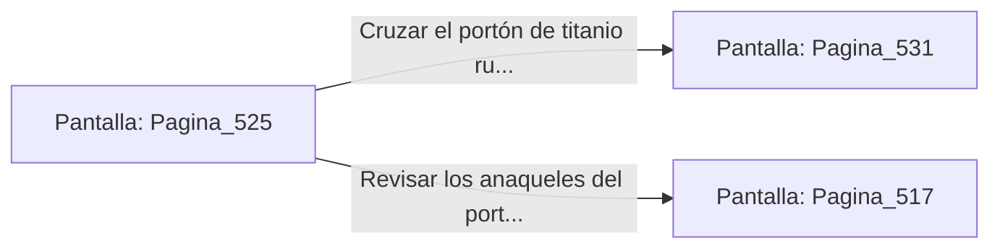

# 📺 Nodo Pantalla: `Pagina_525`

[[Index|⬅️ Índice]] | Fichero Origen: [[sample_eligejuego-code_capitulo_27_mpl|📄 sample/eligejuego-code/capitulo_27.mpl]]

**Narrativa y Encabezado:**
> PÁGINA 525: EL PASO HACIA EL CAPÍTULO 28
> 
> Con la Tarjeta de Nivel Diez autenticada y la rotación de los anillos estabilizada en parámetros perfectos, el imponente portón de titanio del extremo norte se retira lentamente hacia los muros.
> 
> Ante ti se abre la calzada iluminada que conduce a las Cámaras del Capítulo 28, donde aguardan los Santuarios del Ápice del Núcleo.
> 
> Verificas el estado de tus armas y tu equipo médico antes de cruzar el umbral del Capítulo 28.

## 📋 Desglose de Instrucciones de Opciones
### `OPCION "Cruzar el portón de titanio rumbo al Capítulo 28" CON_ACCION TRANSICIONAR_A Pagina_531`
* **Instrucción:** `OPCION` *(Manual: Mapea una entrada o botón interactivo de usuario. Vincular una acción como la invocación de una función C1, un método C2 o una transición C3.)*
* **Efecto de Control:** Dispara `TRANSICIONAR_A` hacia [[Pantalla_Pagina_531|📺 Pagina_531]]
### `OPCION "Revisar los anaqueles del portón en busca de suministros" CON_ACCION TRANSICIONAR_A Pagina_517`
* **Instrucción:** `OPCION` *(Manual: Mapea una entrada o botón interactivo de usuario. Vincular una acción como la invocación de una función C1, un método C2 o una transición C3.)*
* **Efecto de Control:** Dispara `TRANSICIONAR_A` hacia [[Pantalla_Pagina_517|📺 Pagina_517]]

## 📊 Diagrama de Flujo e Interacción (Mermaid)

