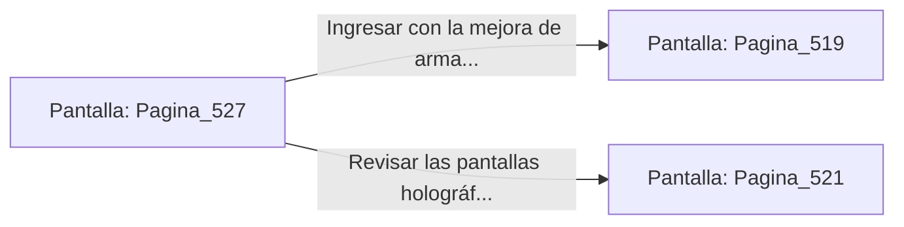

# 📺 Nodo Pantalla: `Pagina_527`

[[Index|⬅️ Índice]] | Fichero Origen: [[sample_eligejuego-code_capitulo_27_mpl|📄 sample/eligejuego-code/capitulo_27.mpl]]

**Narrativa y Encabezado:**
> PÁGINA 527: ANULACIÓN DEL AUTÓMATA DEL ANILLO
> 
> Lanzas la bomba de pulso electromagnético directamente a los pies del autómata pesado. La onda expansiva desactiva de inmediato su cañón de plasma y cortocircuita su núcleo energético.
> 
> La unidad de combate cae inerte sobre las losas de mármol. Al examinar sus restos, recuperas un Cristal de Enfoque Térmico y dos células de éter de alto flujo.
> 
> Adosas el cristal a tu arma de fase antes de cruzar la puerta de salida hacia la Bóveda del Anillo Maestro.

## 📋 Desglose de Instrucciones de Opciones
### `OPCION "Ingresar con la mejora de arma a la Bóveda del Anillo Maestro" CON_ACCION TRANSICIONAR_A Pagina_519`
* **Instrucción:** `OPCION` *(Manual: Mapea una entrada o botón interactivo de usuario. Vincular una acción como la invocación de una función C1, un método C2 o una transición C3.)*
* **Efecto de Control:** Dispara `TRANSICIONAR_A` hacia [[Pantalla_Pagina_519|📺 Pagina_519]]
### `OPCION "Revisar las pantallas holográficas de la pasarela" CON_ACCION TRANSICIONAR_A Pagina_521`
* **Instrucción:** `OPCION` *(Manual: Mapea una entrada o botón interactivo de usuario. Vincular una acción como la invocación de una función C1, un método C2 o una transición C3.)*
* **Efecto de Control:** Dispara `TRANSICIONAR_A` hacia [[Pantalla_Pagina_521|📺 Pagina_521]]

## 📊 Diagrama de Flujo e Interacción (Mermaid)

