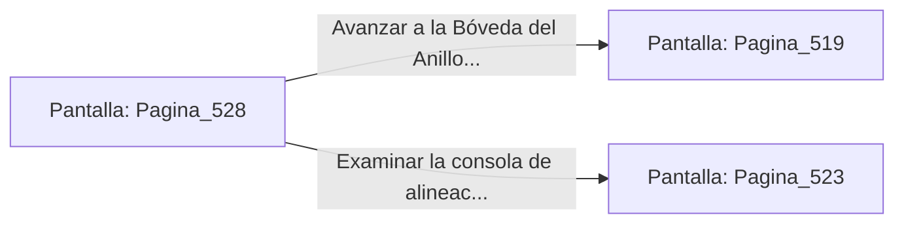

# 📺 Nodo Pantalla: `Pagina_528`

[[Index|⬅️ Índice]] | Fichero Origen: [[sample_eligejuego-code_capitulo_27_mpl|📄 sample/eligejuego-code/capitulo_27.mpl]]

**Narrativa y Encabezado:**
> PÁGINA 528: IMPACTO EN EL CANÓN DE PLASMA
> 
> Descargas una ráfaga con el Rifle Cronal directamente en el tubo de ventilación del cañón de plasma. La sobrecarga provoca la detonación de la munición del autómata, destruyéndolo.
> 
> Con la nave libre, recoges las células de energía y te encarreiras a la salida.

## 📋 Desglose de Instrucciones de Opciones
### `OPCION "Avanzar a la Bóveda del Anillo Maestro" CON_ACCION TRANSICIONAR_A Pagina_519`
* **Instrucción:** `OPCION` *(Manual: Mapea una entrada o botón interactivo de usuario. Vincular una acción como la invocación de una función C1, un método C2 o una transición C3.)*
* **Efecto de Control:** Dispara `TRANSICIONAR_A` hacia [[Pantalla_Pagina_519|📺 Pagina_519]]
### `OPCION "Examinar la consola de alineación de anillos" CON_ACCION TRANSICIONAR_A Pagina_523`
* **Instrucción:** `OPCION` *(Manual: Mapea una entrada o botón interactivo de usuario. Vincular una acción como la invocación de una función C1, un método C2 o una transición C3.)*
* **Efecto de Control:** Dispara `TRANSICIONAR_A` hacia [[Pantalla_Pagina_523|📺 Pagina_523]]

## 📊 Diagrama de Flujo e Interacción (Mermaid)

