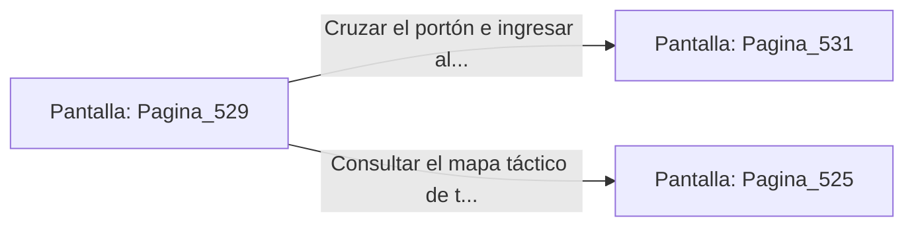

# 📺 Nodo Pantalla: `Pagina_529`

[[Index|⬅️ Índice]] | Fichero Origen: [[sample_eligejuego-code_capitulo_27_mpl|📄 sample/eligejuego-code/capitulo_27.mpl]]

**Narrativa y Encabezado:**
> PÁGINA 529: EL TRIUNFO EN EL ANILLO INTERIOR
> 
> Atraviesas las naves purificadas del Anillo Interior del Núcleo llevando la Tarjeta de Nivel Diez y tu equipo médico al máximo rendimiento. La luz de la columna de fuego esmeralda brilla con un tono dorado pacífico.
> 
> Tu Brazal de Convergencia confirma que las Cámaras 511 a 530 han sido estabilizadas con éxito dentro de la red del complejo.
> 
> Te detienes frente al portón del Capítulo 28 con la certeza de haber superado el tramo más peligroso del núcleo.

## 📋 Desglose de Instrucciones de Opciones
### `OPCION "Cruzar el portón e ingresar al Capítulo 28" CON_ACCION TRANSICIONAR_A Pagina_531`
* **Instrucción:** `OPCION` *(Manual: Mapea una entrada o botón interactivo de usuario. Vincular una acción como la invocación de una función C1, un método C2 o una transición C3.)*
* **Efecto de Control:** Dispara `TRANSICIONAR_A` hacia [[Pantalla_Pagina_531|📺 Pagina_531]]
### `OPCION "Consultar el mapa táctico de tu Brazal" CON_ACCION TRANSICIONAR_A Pagina_525`
* **Instrucción:** `OPCION` *(Manual: Mapea una entrada o botón interactivo de usuario. Vincular una acción como la invocación de una función C1, un método C2 o una transición C3.)*
* **Efecto de Control:** Dispara `TRANSICIONAR_A` hacia [[Pantalla_Pagina_525|📺 Pagina_525]]

## 📊 Diagrama de Flujo e Interacción (Mermaid)

