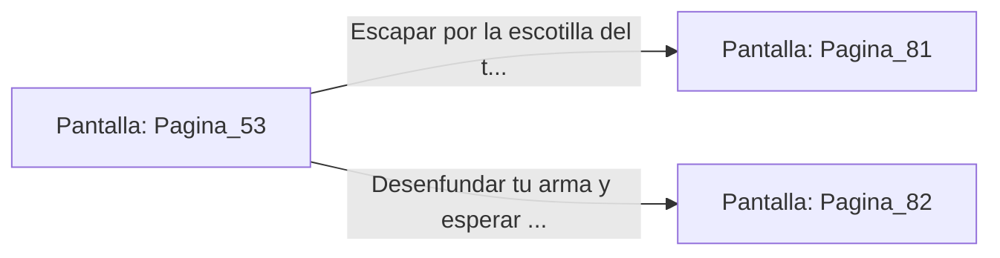

# 📺 Nodo Pantalla: `Pagina_53`

[[Index|⬅️ Índice]] | Fichero Origen: [[sample_eligejuego-code_capitulo_04_mpl|📄 sample/eligejuego-code/capitulo_04.mpl]]

**Narrativa y Encabezado:**
> PÁGINA 53: EL ASCENSOR DE CARGA
> 
> Las pesadas puertas de hierro del ascensor se abren con un chasquido hidráulico. Subes a la plataforma y tiras de la palanca de descenso, sintiendo cómo el elevador cae bruscamente varios metros antes de estabilizar su velocidad.
> 
> A través de las rejas de la cabina ves pasar los distintos niveles de la ciudadela: almacenes, barracones de autómatas y talleres de alquimia. Sin embargo, en el nivel intermedio, el indicador del ascensor se detiene y una luz roja de advertencia comienza a parpadear.
> 
> Un bloqueo manual ha sido activado desde el exterior. Puedes forzar la escotilla del techo del ascensor o preparar tu arma para encarar a quien haya detenido la cabina.

## 📋 Desglose de Instrucciones de Opciones
### `OPCION "Escapar por la escotilla del techo del ascensor hacia los cables" CON_ACCION TRANSICIONAR_A Pagina_81`
* **Instrucción:** `OPCION` *(Manual: Mapea una entrada o botón interactivo de usuario. Vincular una acción como la invocación de una función C1, un método C2 o una transición C3.)*
* **Efecto de Control:** Dispara `TRANSICIONAR_A` hacia [[Pantalla_Pagina_81|📺 Pagina_81]]
### `OPCION "Desenfundar tu arma y esperar a que se abran las puertas" CON_ACCION TRANSICIONAR_A Pagina_82`
* **Instrucción:** `OPCION` *(Manual: Mapea una entrada o botón interactivo de usuario. Vincular una acción como la invocación de una función C1, un método C2 o una transición C3.)*
* **Efecto de Control:** Dispara `TRANSICIONAR_A` hacia [[Pantalla_Pagina_82|📺 Pagina_82]]

## 📊 Diagrama de Flujo e Interacción (Mermaid)

