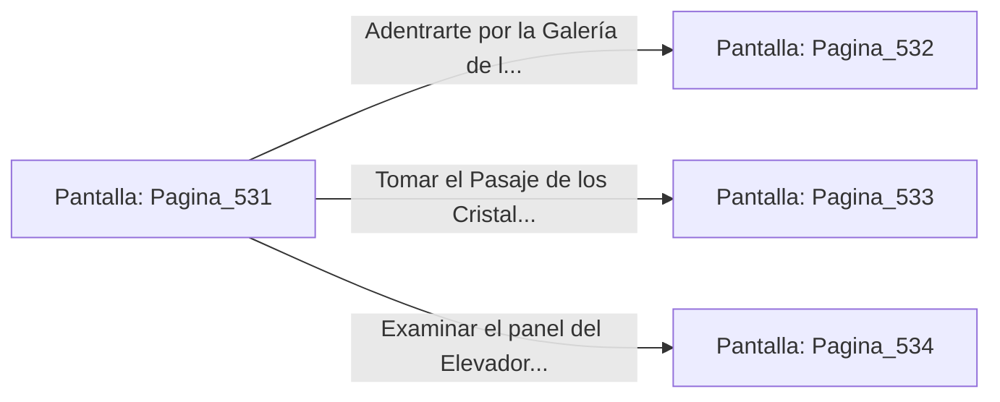

# 📺 Nodo Pantalla: `Pagina_531`

[[Index|⬅️ Índice]] | Fichero Origen: [[sample_eligejuego-code_capitulo_28_mpl|📄 sample/eligejuego-code/capitulo_28.mpl]]

**Narrativa y Encabezado:**
> PÁGINA 531: EL UMBRAL DEL ÁPICE DEL NÚCLEO
> 
> Atraviesas el portón de titanio y accedes a la majestuosa nave de los Santuarios del Ápice del Núcleo. Columnas de cristal puro cargadas de luz estelar sostienen bóvedas de mármol negro, mientras una brisa cargada de esencias rúnicas recorre los pasillos limpios de residuos de la batalla.
> 
> Tu Brazal de Convergencia indica que las Cámaras 531 a 550 forman el penúltimo anillo de contención mnemónica. Guardiánes del Ápice Primordiales, armados con bastones de dispersión y escudos de energía estelar, custodian los accesos a la Cámara del Consejo Final.
> 
> Frente a ti se abren tres vías de avance: la Galerias de las Luminarias, el Pasaje de los Cristales Estelares y el Elevador de Servicio del Ápice.

## 📋 Desglose de Instrucciones de Opciones
### `OPCION "Adentrarte por la Galería de las Luminarias" CON_ACCION TRANSICIONAR_A Pagina_532`
* **Instrucción:** `OPCION` *(Manual: Mapea una entrada o botón interactivo de usuario. Vincular una acción como la invocación de una función C1, un método C2 o una transición C3.)*
* **Efecto de Control:** Dispara `TRANSICIONAR_A` hacia [[Pantalla_Pagina_532|📺 Pagina_532]]
### `OPCION "Tomar el Pasaje de los Cristales Estelares" CON_ACCION TRANSICIONAR_A Pagina_533`
* **Instrucción:** `OPCION` *(Manual: Mapea una entrada o botón interactivo de usuario. Vincular una acción como la invocación de una función C1, un método C2 o una transición C3.)*
* **Efecto de Control:** Dispara `TRANSICIONAR_A` hacia [[Pantalla_Pagina_533|📺 Pagina_533]]
### `OPCION "Examinar el panel del Elevador de Servicio del Ápice" CON_ACCION TRANSICIONAR_A Pagina_534`
* **Instrucción:** `OPCION` *(Manual: Mapea una entrada o botón interactivo de usuario. Vincular una acción como la invocación de una función C1, un método C2 o una transición C3.)*
* **Efecto de Control:** Dispara `TRANSICIONAR_A` hacia [[Pantalla_Pagina_534|📺 Pagina_534]]

## 📊 Diagrama de Flujo e Interacción (Mermaid)

