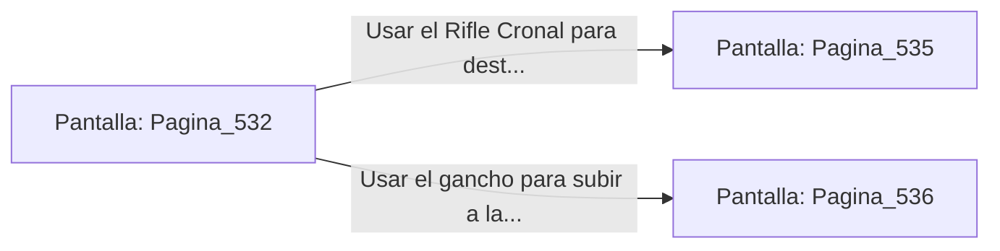

# 📺 Nodo Pantalla: `Pagina_532`

[[Index|⬅️ Índice]] | Fichero Origen: [[sample_eligejuego-code_capitulo_28_mpl|📄 sample/eligejuego-code/capitulo_28.mpl]]

**Narrativa y Encabezado:**
> PÁGINA 532: LA GALERÍA DE LAS LUMINARIAS
> 
> Avanzas con paso firme sobre las losas de mármol negro. A ambos lados de la galería, esferas de cristal de éter flotan en hornacinas de bronce, emitiendo una luz dorada y cálida que disipa cualquier rastro de la penumbra abisal.
> 
> A mitad de camino, dos Guardianes del Ápice bajan sus bastones de dispersión y bloquean el acceso al portal central.

## 📋 Desglose de Instrucciones de Opciones
### `OPCION "Usar el Rifle Cronal para destruir los emisores de los bastones" CON_ACCION TRANSICIONAR_A Pagina_535`
* **Instrucción:** `OPCION` *(Manual: Mapea una entrada o botón interactivo de usuario. Vincular una acción como la invocación de una función C1, un método C2 o una transición C3.)*
* **Efecto de Control:** Dispara `TRANSICIONAR_A` hacia [[Pantalla_Pagina_535|📺 Pagina_535]]
### `OPCION "Usar el gancho para subir a la cornisa del muro superior" CON_ACCION TRANSICIONAR_A Pagina_536`
* **Instrucción:** `OPCION` *(Manual: Mapea una entrada o botón interactivo de usuario. Vincular una acción como la invocación de una función C1, un método C2 o una transición C3.)*
* **Efecto de Control:** Dispara `TRANSICIONAR_A` hacia [[Pantalla_Pagina_536|📺 Pagina_536]]

## 📊 Diagrama de Flujo e Interacción (Mermaid)

