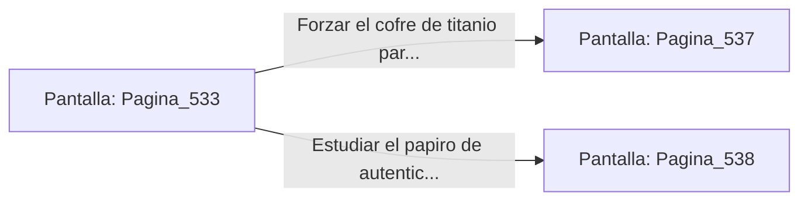

# 📺 Nodo Pantalla: `Pagina_533`

[[Index|⬅️ Índice]] | Fichero Origen: [[sample_eligejuego-code_capitulo_28_mpl|📄 sample/eligejuego-code/capitulo_28.mpl]]

**Narrativa y Encabezado:**
> PÁGINA 533: EL PASAJE DE LOS CRISTALES ESTELARES
> 
> Te adentras por el pasaje flanqueado por columnas de cristal que canalizan el flujo de luz de la tormenta exterior de Aethelgard. La energía pura hace vibrar los sensores de tu visor táctico con intensidades doradas.
> 
> Tras superar el tramo central, alcanzas una cámara de consulta donde descansa un altar de lecturas con un cofre de titanio y un papiro de autenticación.
> 
> Tienes la opción de forzar el cofre para recuperar tónicos curativos o estudiar el papiro en busca de claves de acceso al santuario.

## 📋 Desglose de Instrucciones de Opciones
### `OPCION "Forzar el cofre de titanio para recuperar tónicos de salud" CON_ACCION TRANSICIONAR_A Pagina_537`
* **Instrucción:** `OPCION` *(Manual: Mapea una entrada o botón interactivo de usuario. Vincular una acción como la invocación de una función C1, un método C2 o una transición C3.)*
* **Efecto de Control:** Dispara `TRANSICIONAR_A` hacia [[Pantalla_Pagina_537|📺 Pagina_537]]
### `OPCION "Estudiar el papiro de autenticación en busca de claves" CON_ACCION TRANSICIONAR_A Pagina_538`
* **Instrucción:** `OPCION` *(Manual: Mapea una entrada o botón interactivo de usuario. Vincular una acción como la invocación de una función C1, un método C2 o una transición C3.)*
* **Efecto de Control:** Dispara `TRANSICIONAR_A` hacia [[Pantalla_Pagina_538|📺 Pagina_538]]

## 📊 Diagrama de Flujo e Interacción (Mermaid)

