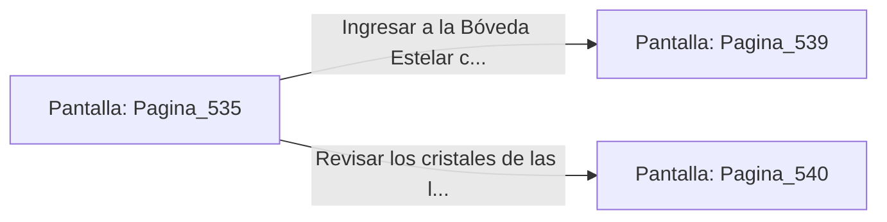

# 📺 Nodo Pantalla: `Pagina_535`

[[Index|⬅️ Índice]] | Fichero Origen: [[sample_eligejuego-code_capitulo_28_mpl|📄 sample/eligejuego-code/capitulo_28.mpl]]

**Narrativa y Encabezado:**
> PÁGINA 535: DESTRUCCIÓN EN LAS LUMINARIAS
> 
> Alineas la mira del Rifle Cronal y descargas dos ráfagas de aceleración concisa. Los proyectiles estallan contra los emisores de los bastones, provocando una explosión de luz estelar que desarticula la forma de los dos Guardianes del Ápice.
> 
> Con la galería libre, alcanzas el descansillo del fondo donde hallas un nicho blindado con dos Células de Éter Sobrecargadas y la Tarjeta de Acceso a la Bóveda Estelar.
> 
> Sincronizas los componentes con tu arnés antes de dirigirte a la entrada de la Bóveda Estelar.

## 📋 Desglose de Instrucciones de Opciones
### `OPCION "Ingresar a la Bóveda Estelar con la tarjeta de acceso" CON_ACCION TRANSICIONAR_A Pagina_539`
* **Instrucción:** `OPCION` *(Manual: Mapea una entrada o botón interactivo de usuario. Vincular una acción como la invocación de una función C1, un método C2 o una transición C3.)*
* **Efecto de Control:** Dispara `TRANSICIONAR_A` hacia [[Pantalla_Pagina_539|📺 Pagina_539]]
### `OPCION "Revisar los cristales de las luminarias contiguas" CON_ACCION TRANSICIONAR_A Pagina_540`
* **Instrucción:** `OPCION` *(Manual: Mapea una entrada o botón interactivo de usuario. Vincular una acción como la invocación de una función C1, un método C2 o una transición C3.)*
* **Efecto de Control:** Dispara `TRANSICIONAR_A` hacia [[Pantalla_Pagina_540|📺 Pagina_540]]

## 📊 Diagrama de Flujo e Interacción (Mermaid)

