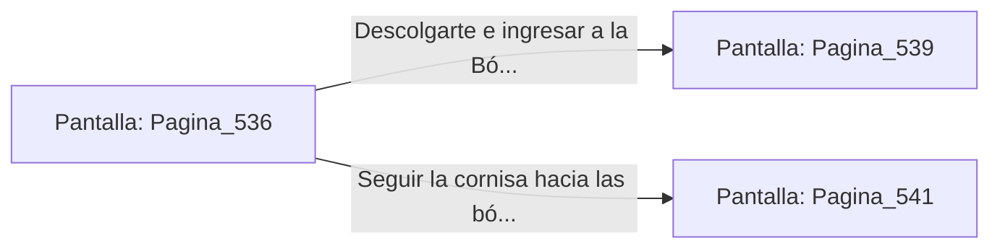

# 📺 Nodo Pantalla: `Pagina_536`

[[Index|⬅️ Índice]] | Fichero Origen: [[sample_eligejuego-code_capitulo_28_mpl|📄 sample/eligejuego-code/capitulo_28.mpl]]

**Narrativa y Encabezado:**
> PÁGINA 536: EVASIÓN POR LA CORNISA DE MÁRMOL
> 
> Disparas el gancho de agarre y te elevas hacia la cornisa de mármol negro del muro, dejando abajo a los Guardianes del Ápice. Avanzas por la estructura con agilidad hasta superar la zona de vigilancia.
> 
> Te descuelgas limpiamente al otro lado de la galería frente a la puerta del santuario.

## 📋 Desglose de Instrucciones de Opciones
### `OPCION "Descolgarte e ingresar a la Bóveda Estelar" CON_ACCION TRANSICIONAR_A Pagina_539`
* **Instrucción:** `OPCION` *(Manual: Mapea una entrada o botón interactivo de usuario. Vincular una acción como la invocación de una función C1, un método C2 o una transición C3.)*
* **Efecto de Control:** Dispara `TRANSICIONAR_A` hacia [[Pantalla_Pagina_539|📺 Pagina_539]]
### `OPCION "Seguir la cornisa hacia las bóvedas de consulta" CON_ACCION TRANSICIONAR_A Pagina_541`
* **Instrucción:** `OPCION` *(Manual: Mapea una entrada o botón interactivo de usuario. Vincular una acción como la invocación de una función C1, un método C2 o una transición C3.)*
* **Efecto de Control:** Dispara `TRANSICIONAR_A` hacia [[Pantalla_Pagina_541|📺 Pagina_541]]

## 📊 Diagrama de Flujo e Interacción (Mermaid)

