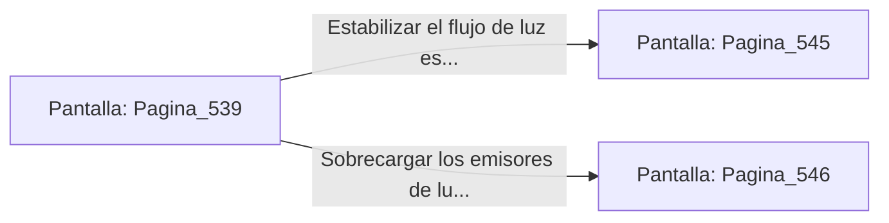

# 📺 Nodo Pantalla: `Pagina_539`

[[Index|⬅️ Índice]] | Fichero Origen: [[sample_eligejuego-code_capitulo_28_mpl|📄 sample/eligejuego-code/capitulo_28.mpl]]

**Narrativa y Encabezado:**
> PÁGINA 539: LA BÓVEDA ESTELAR
> 
> Deslizas la tarjeta de acceso por la ranura rúnica e ingresas a la vasta Bóveda Estelar. Columnas de cuarzo transparente canalizan haces de luz dorada hacia el altar central donde flota la Llave del Ápice del Núcleo.
> 
> En la consola principal brilla la Tarjeta de Nivel Once y un conmutador de purga que permite estabilizar el flujo de luz estelar o sobrecargar los emisores.
> 
> Sincronizas la Tarjeta de Nivel Once en tu Brazal de Convergencia antes de operar los mandos de la consola.

## 📋 Desglose de Instrucciones de Opciones
### `OPCION "Estabilizar el flujo de luz estelar en la consola central" CON_ACCION TRANSICIONAR_A Pagina_545`
* **Instrucción:** `OPCION` *(Manual: Mapea una entrada o botón interactivo de usuario. Vincular una acción como la invocación de una función C1, un método C2 o una transición C3.)*
* **Efecto de Control:** Dispara `TRANSICIONAR_A` hacia [[Pantalla_Pagina_545|📺 Pagina_545]]
### `OPCION "Sobrecargar los emisores de luz para neutralizar la guardia" CON_ACCION TRANSICIONAR_A Pagina_546`
* **Instrucción:** `OPCION` *(Manual: Mapea una entrada o botón interactivo de usuario. Vincular una acción como la invocación de una función C1, un método C2 o una transición C3.)*
* **Efecto de Control:** Dispara `TRANSICIONAR_A` hacia [[Pantalla_Pagina_546|📺 Pagina_546]]

## 📊 Diagrama de Flujo e Interacción (Mermaid)

