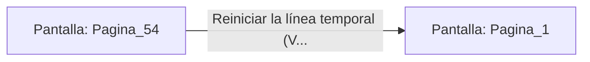

# 📺 Nodo Pantalla: `Pagina_54`

[[Index|⬅️ Índice]] | Fichero Origen: [[sample_eligejuego-code_capitulo_04_mpl|📄 sample/eligejuego-code/capitulo_04.mpl]]

**Narrativa y Encabezado:**
> PÁGINA 54: FALLO EN EL PARACAÍDAS
> 
> Te lanzas por el conducto de desecho y despliegas el paracaídas energético, pero la interferencia electromagnética de la torre neutraliza el velo de plasma, haciéndote estrellar contra el suelo de granito a velocidad terminal.

## 📋 Desglose de Instrucciones de Opciones
### `OPCION "Reiniciar la línea temporal (Volver al Inicio)" CON_ACCION TRANSICIONAR_A Pagina_1`
* **Instrucción:** `OPCION` *(Manual: Mapea una entrada o botón interactivo de usuario. Vincular una acción como la invocación de una función C1, un método C2 o una transición C3.)*
* **Efecto de Control:** Dispara `TRANSICIONAR_A` hacia [[Pantalla_Pagina_1|📺 Pagina_1]]

## 📊 Diagrama de Flujo e Interacción (Mermaid)

