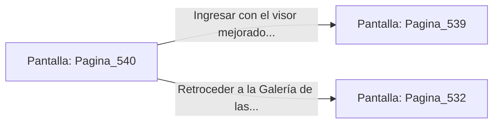

# 📺 Nodo Pantalla: `Pagina_540`

[[Index|⬅️ Índice]] | Fichero Origen: [[sample_eligejuego-code_capitulo_28_mpl|📄 sample/eligejuego-code/capitulo_28.mpl]]

**Narrativa y Encabezado:**
> PÁGINA 540: REVISIÓN DE CRISTALES ESTELARES
> 
> Examinas los cristales de las luminarias contiguas y recuperas un visor de enfoque mnemónico que adosas al casco de tu armadura.
> 
> Con la mejora integrada, ingresas a la Bóveda Estelar.

## 📋 Desglose de Instrucciones de Opciones
### `OPCION "Ingresar con el visor mejorado a la Bóveda Estelar" CON_ACCION TRANSICIONAR_A Pagina_539`
* **Instrucción:** `OPCION` *(Manual: Mapea una entrada o botón interactivo de usuario. Vincular una acción como la invocación de una función C1, un método C2 o una transición C3.)*
* **Efecto de Control:** Dispara `TRANSICIONAR_A` hacia [[Pantalla_Pagina_539|📺 Pagina_539]]
### `OPCION "Retroceder a la Galería de las Luminarias" CON_ACCION TRANSICIONAR_A Pagina_532`
* **Instrucción:** `OPCION` *(Manual: Mapea una entrada o botón interactivo de usuario. Vincular una acción como la invocación de una función C1, un método C2 o una transición C3.)*
* **Efecto de Control:** Dispara `TRANSICIONAR_A` hacia [[Pantalla_Pagina_532|📺 Pagina_532]]

## 📊 Diagrama de Flujo e Interacción (Mermaid)

