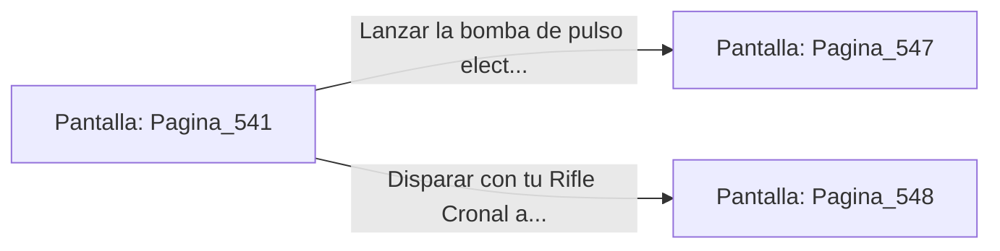

# 📺 Nodo Pantalla: `Pagina_541`

[[Index|⬅️ Índice]] | Fichero Origen: [[sample_eligejuego-code_capitulo_28_mpl|📄 sample/eligejuego-code/capitulo_28.mpl]]

**Narrativa y Encabezado:**
> PÁGINA 541: LAS BÓVEDAS DE CONSULTA DEL ÁPICE
> 
> Te descuelgas a las Bóvedas de Consulta del Ápice. Esferas de luz cristalina albergan los planos de construcción del Núcleo Maestro de Aethelgard, emitiendo una melodía pacífica y armónica.
> 
> Un autómata guardián de titanio custodia la peana central esgrimiendo una espada de energía estelar. La unidad detecta tu presencia e inicia el protocolo de erradicación.
> 
> Puedes usar la bomba de pulso electromagnético para anular su escudo o disparar con tu Rifle Cronal al conector de su pecho.

## 📋 Desglose de Instrucciones de Opciones
### `OPCION "Lanzar la bomba de pulso electromagnético contra el autómata" CON_ACCION TRANSICIONAR_A Pagina_547`
* **Instrucción:** `OPCION` *(Manual: Mapea una entrada o botón interactivo de usuario. Vincular una acción como la invocación de una función C1, un método C2 o una transición C3.)*
* **Efecto de Control:** Dispara `TRANSICIONAR_A` hacia [[Pantalla_Pagina_547|📺 Pagina_547]]
### `OPCION "Disparar con tu Rifle Cronal al conector de su pecho" CON_ACCION TRANSICIONAR_A Pagina_548`
* **Instrucción:** `OPCION` *(Manual: Mapea una entrada o botón interactivo de usuario. Vincular una acción como la invocación de una función C1, un método C2 o una transición C3.)*
* **Efecto de Control:** Dispara `TRANSICIONAR_A` hacia [[Pantalla_Pagina_548|📺 Pagina_548]]

## 📊 Diagrama de Flujo e Interacción (Mermaid)

