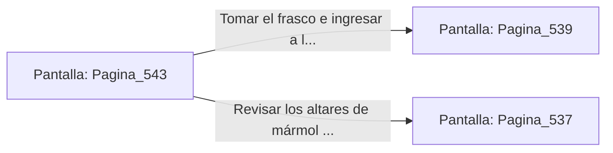

# 📺 Nodo Pantalla: `Pagina_543`

[[Index|⬅️ Índice]] | Fichero Origen: [[sample_eligejuego-code_capitulo_28_mpl|📄 sample/eligejuego-code/capitulo_28.mpl]]

**Narrativa y Encabezado:**
> PÁGINA 543: EL SANTUARIO DE LAS LUMINARIAS
> 
> Ingresas al Santuario de las Luminarias. Una gran columna de fuego dorado conecta el suelo con el techo abovedado, alimentando la energía limpia de las últimas cámaras del complejo.
> 
> En la peana central reposa un frasco de Éter Puro Concentrado y la clave de acceso a los Santuarios Finales del Capítulo 29.
> 
> Te apoderas del frasco y sincronizas la clave en tu Brazal antes de avanzar a la Bóveda Estelar.

## 📋 Desglose de Instrucciones de Opciones
### `OPCION "Tomar el frasco e ingresar a la Bóveda Estelar" CON_ACCION TRANSICIONAR_A Pagina_539`
* **Instrucción:** `OPCION` *(Manual: Mapea una entrada o botón interactivo de usuario. Vincular una acción como la invocación de una función C1, un método C2 o una transición C3.)*
* **Efecto de Control:** Dispara `TRANSICIONAR_A` hacia [[Pantalla_Pagina_539|📺 Pagina_539]]
### `OPCION "Revisar los altares de mármol del santuario" CON_ACCION TRANSICIONAR_A Pagina_537`
* **Instrucción:** `OPCION` *(Manual: Mapea una entrada o botón interactivo de usuario. Vincular una acción como la invocación de una función C1, un método C2 o una transición C3.)*
* **Efecto de Control:** Dispara `TRANSICIONAR_A` hacia [[Pantalla_Pagina_537|📺 Pagina_537]]

## 📊 Diagrama de Flujo e Interacción (Mermaid)

