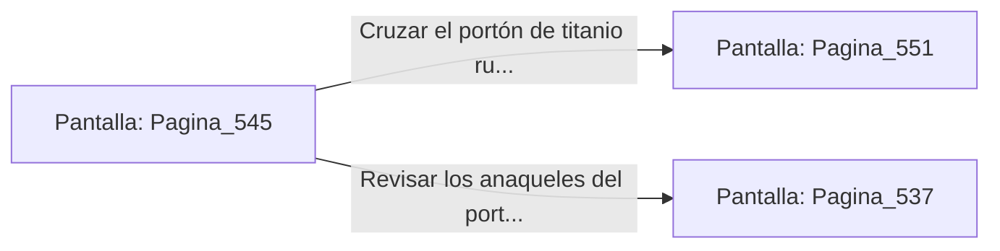

# 📺 Nodo Pantalla: `Pagina_545`

[[Index|⬅️ Índice]] | Fichero Origen: [[sample_eligejuego-code_capitulo_28_mpl|📄 sample/eligejuego-code/capitulo_28.mpl]]

**Narrativa y Encabezado:**
> PÁGINA 545: EL PASO HACIA EL CAPÍTULO 29
> 
> Con la Tarjeta de Nivel Once autenticada y el flujo de luz estelar estabilizado en parámetros perfectos, el gran portón acorazado de titanio del extremo norte se abre suavemente en dos mitades.
> 
> Ante ti se despliega la calzada iluminada por luz esmeralda y dorada que conduce hacia las Cámaras del Capítulo 29, donde aguardan las Bóvedas de la Gran Purga.
> 
> Verificas el estado de tus armas y tu equipo médico antes de cruzar el umbral con determinación.

## 📋 Desglose de Instrucciones de Opciones
### `OPCION "Cruzar el portón de titanio rumbo al Capítulo 29" CON_ACCION TRANSICIONAR_A Pagina_551`
* **Instrucción:** `OPCION` *(Manual: Mapea una entrada o botón interactivo de usuario. Vincular una acción como la invocación de una función C1, un método C2 o una transición C3.)*
* **Efecto de Control:** Dispara `TRANSICIONAR_A` hacia [[Pantalla_Pagina_551|📺 Pagina_551]]
### `OPCION "Revisar los anaqueles del portón en busca de suministros" CON_ACCION TRANSICIONAR_A Pagina_537`
* **Instrucción:** `OPCION` *(Manual: Mapea una entrada o botón interactivo de usuario. Vincular una acción como la invocación de una función C1, un método C2 o una transición C3.)*
* **Efecto de Control:** Dispara `TRANSICIONAR_A` hacia [[Pantalla_Pagina_537|📺 Pagina_537]]

## 📊 Diagrama de Flujo e Interacción (Mermaid)

