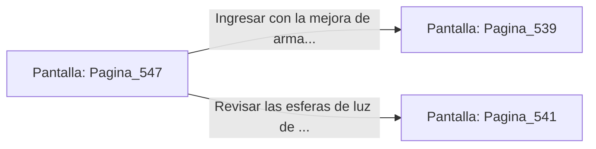

# 📺 Nodo Pantalla: `Pagina_547`

[[Index|⬅️ Índice]] | Fichero Origen: [[sample_eligejuego-code_capitulo_28_mpl|📄 sample/eligejuego-code/capitulo_28.mpl]]

**Narrativa y Encabezado:**
> PÁGINA 547: ANULACIÓN DEL GUARDIÁN ESTELAR
> 
> Lanzas la bomba de pulso electromagnético a los pies del autómata de titanio. La onda expansiva desactiva su escudo de energía y sobrecarga los circuitos de su torso.
> 
> La unidad colapsa inerte sobre el piso de mármol negro. Al examinar sus restos, recuperas un Cristal de Enfoque Térmico y dos células de energía de alto flujo.
> 
> Adosas el cristal a tu arma de fase antes de cruzar la puerta de salida hacia la Bóveda Estelar.

## 📋 Desglose de Instrucciones de Opciones
### `OPCION "Ingresar con la mejora de arma a la Bóveda Estelar" CON_ACCION TRANSICIONAR_A Pagina_539`
* **Instrucción:** `OPCION` *(Manual: Mapea una entrada o botón interactivo de usuario. Vincular una acción como la invocación de una función C1, un método C2 o una transición C3.)*
* **Efecto de Control:** Dispara `TRANSICIONAR_A` hacia [[Pantalla_Pagina_539|📺 Pagina_539]]
### `OPCION "Revisar las esferas de luz de la sala" CON_ACCION TRANSICIONAR_A Pagina_541`
* **Instrucción:** `OPCION` *(Manual: Mapea una entrada o botón interactivo de usuario. Vincular una acción como la invocación de una función C1, un método C2 o una transición C3.)*
* **Efecto de Control:** Dispara `TRANSICIONAR_A` hacia [[Pantalla_Pagina_541|📺 Pagina_541]]

## 📊 Diagrama de Flujo e Interacción (Mermaid)

