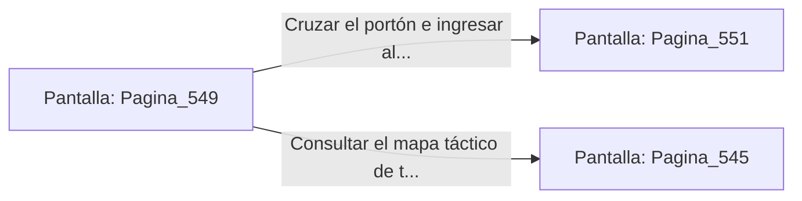

# 📺 Nodo Pantalla: `Pagina_549`

[[Index|⬅️ Índice]] | Fichero Origen: [[sample_eligejuego-code_capitulo_28_mpl|📄 sample/eligejuego-code/capitulo_28.mpl]]

**Narrativa y Encabezado:**
> PÁGINA 549: EL TRIUNFO EN EL ÁPICE DEL NÚCLEO
> 
> Atraviesas las naves purificadas de los Santuarios del Ápice llevando la Tarjeta de Nivel Once y tus reservas curativas reabastecidas. La luz de las luminarias brillan con un tono dorado pacífico.
> 
> Tu Brazal de Convergencia confirma que las Cámaras 531 a 550 han sido estabilizadas con éxito dentro de la red del complejo.
> 
> Te detienes un instante frente al portón del Capítulo 29 con la certeza de hallarte a un paso de las cámaras finales.

## 📋 Desglose de Instrucciones de Opciones
### `OPCION "Cruzar el portón e ingresar al Capítulo 29" CON_ACCION TRANSICIONAR_A Pagina_551`
* **Instrucción:** `OPCION` *(Manual: Mapea una entrada o botón interactivo de usuario. Vincular una acción como la invocación de una función C1, un método C2 o una transición C3.)*
* **Efecto de Control:** Dispara `TRANSICIONAR_A` hacia [[Pantalla_Pagina_551|📺 Pagina_551]]
### `OPCION "Consultar el mapa táctico de tu Brazal" CON_ACCION TRANSICIONAR_A Pagina_545`
* **Instrucción:** `OPCION` *(Manual: Mapea una entrada o botón interactivo de usuario. Vincular una acción como la invocación de una función C1, un método C2 o una transición C3.)*
* **Efecto de Control:** Dispara `TRANSICIONAR_A` hacia [[Pantalla_Pagina_545|📺 Pagina_545]]

## 📊 Diagrama de Flujo e Interacción (Mermaid)

