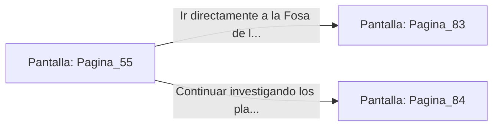

# 📺 Nodo Pantalla: `Pagina_55`

[[Index|⬅️ Índice]] | Fichero Origen: [[sample_eligejuego-code_capitulo_04_mpl|📄 sample/eligejuego-code/capitulo_04.mpl]]

**Narrativa y Encabezado:**
> PÁGINA 55: UBICACIÓN DEL PRIMER SELLO
> 
> La inteligencia artificial del Gran Archivo despliega un mapa holográfico de alta resolución. Una esfera parpadeante señala la localización exacta del Primer Sello de Fase: se halla sumergido en la Fosa de los Juramentos, custodiado por un Espectro Temporal de primera generación.
> 
> El archivo revela además una contraseña secreta de desactivación que anula el escudo primario del Espectro durante diez segundos. Tu Brazal almacena la clave mnemónica automáticamente.
> 
> Con la ubicación y la contraseña registradas, debes decidir si dirigirte directamente a la Fosa de los Juramentos o buscar mapas tácticos adicionales sobre los otros dos sellos.

## 📋 Desglose de Instrucciones de Opciones
### `OPCION "Ir directamente a la Fosa de los Juramentos" CON_ACCION TRANSICIONAR_A Pagina_83`
* **Instrucción:** `OPCION` *(Manual: Mapea una entrada o botón interactivo de usuario. Vincular una acción como la invocación de una función C1, un método C2 o una transición C3.)*
* **Efecto de Control:** Dispara `TRANSICIONAR_A` hacia [[Pantalla_Pagina_83|📺 Pagina_83]]
### `OPCION "Continuar investigando los planos de los otros dos sellos" CON_ACCION TRANSICIONAR_A Pagina_84`
* **Instrucción:** `OPCION` *(Manual: Mapea una entrada o botón interactivo de usuario. Vincular una acción como la invocación de una función C1, un método C2 o una transición C3.)*
* **Efecto de Control:** Dispara `TRANSICIONAR_A` hacia [[Pantalla_Pagina_84|📺 Pagina_84]]

## 📊 Diagrama de Flujo e Interacción (Mermaid)

