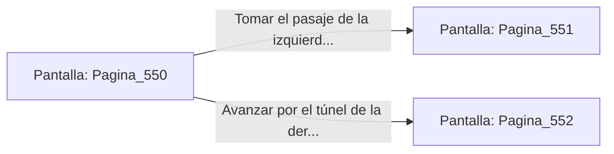

# 📺 Nodo Pantalla: `Pagina_550`

[[Index|⬅️ Índice]] | Fichero Origen: [[sample_eligejuego-code_capitulo_10_trono_oscarpu_mpl|📄 sample/eligejuego-code/capitulo_10_trono_oscarpu.mpl]]

**Narrativa y Encabezado:**
> Página 550: El Gran Trono de Oscarpu
> 
> El gran trono de obsidiana del Rey Nigromante Oscarpu domina el salón rodeado por un ejército de espectros. Te encuentras ante una encrucijada en la penumbra de la mazmorra. Debes tomar una decisión.

## 📋 Desglose de Instrucciones de Opciones
### `OPCION "Tomar el pasaje de la izquierda (Página 551)" CON_ACCION TRANSICIONAR_A Pagina_551`
* **Instrucción:** `OPCION` *(Manual: Mapea una entrada o botón interactivo de usuario. Vincular una acción como la invocación de una función C1, un método C2 o una transición C3.)*
* **Efecto de Control:** Dispara `TRANSICIONAR_A` hacia [[Pantalla_Pagina_551|📺 Pagina_551]]
### `OPCION "Avanzar por el túnel de la derecha (Página 552)" CON_ACCION TRANSICIONAR_A Pagina_552`
* **Instrucción:** `OPCION` *(Manual: Mapea una entrada o botón interactivo de usuario. Vincular una acción como la invocación de una función C1, un método C2 o una transición C3.)*
* **Efecto de Control:** Dispara `TRANSICIONAR_A` hacia [[Pantalla_Pagina_552|📺 Pagina_552]]

## 📊 Diagrama de Flujo e Interacción (Mermaid)

