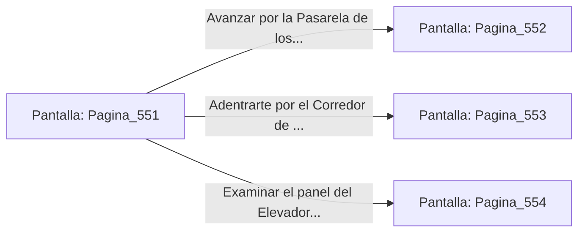

# 📺 Nodo Pantalla: `Pagina_551`

[[Index|⬅️ Índice]] | Fichero Origen: [[sample_eligejuego-code_capitulo_29_mpl|📄 sample/eligejuego-code/capitulo_29.mpl]]

**Narrativa y Encabezado:**
> PÁGINA 551: EL UMBRAL DE LA GRAN PURGA
> 
> Atraviesas el portón de titanio e ingresas a la sobrecogedora nave de las Bóvedas de la Gran Purga. Columnas de obsidiana negra surcadas por vetas de éter esmeralda se elevan hacia una cúpula acristalada que deja ver los relámpagos de la tormenta cronal exterior.
> 
> Tu Brazal de Convergencia indica que las Cámaras 551 a 570 alojan los filtros de resonancia que purifican el flujo energético antes de alimentarlo al Núcleo Maestro. Ejecutores de la Purga Primordiales, armados con guadañas de fase y escudos refractarios de alta densidad, patrullan la calzada circular.
> 
> Frente a ti se despliegan tres vías para atravesar el sector: la Pasarela de los Filtros de Resonancia, el Corredor de los Condensadores de Éter y el Elevador de Purga Automático.

## 📋 Desglose de Instrucciones de Opciones
### `OPCION "Avanzar por la Pasarela de los Filtros de Resonancia" CON_ACCION TRANSICIONAR_A Pagina_552`
* **Instrucción:** `OPCION` *(Manual: Mapea una entrada o botón interactivo de usuario. Vincular una acción como la invocación de una función C1, un método C2 o una transición C3.)*
* **Efecto de Control:** Dispara `TRANSICIONAR_A` hacia [[Pantalla_Pagina_552|📺 Pagina_552]]
### `OPCION "Adentrarte por el Corredor de los Condensadores de Éter" CON_ACCION TRANSICIONAR_A Pagina_553`
* **Instrucción:** `OPCION` *(Manual: Mapea una entrada o botón interactivo de usuario. Vincular una acción como la invocación de una función C1, un método C2 o una transición C3.)*
* **Efecto de Control:** Dispara `TRANSICIONAR_A` hacia [[Pantalla_Pagina_553|📺 Pagina_553]]
### `OPCION "Examinar el panel del Elevador de Purga Automático" CON_ACCION TRANSICIONAR_A Pagina_554`
* **Instrucción:** `OPCION` *(Manual: Mapea una entrada o botón interactivo de usuario. Vincular una acción como la invocación de una función C1, un método C2 o una transición C3.)*
* **Efecto de Control:** Dispara `TRANSICIONAR_A` hacia [[Pantalla_Pagina_554|📺 Pagina_554]]

## 📊 Diagrama de Flujo e Interacción (Mermaid)

