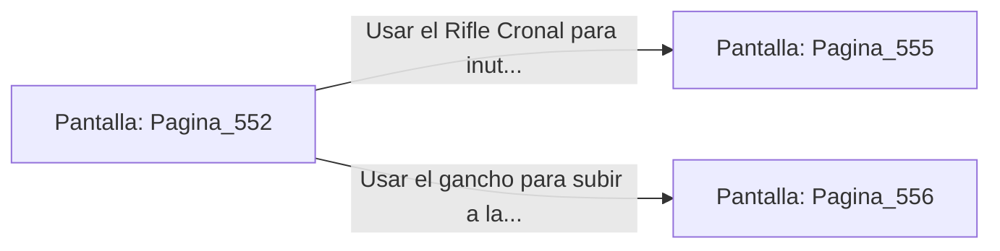

# 📺 Nodo Pantalla: `Pagina_552`

[[Index|⬅️ Índice]] | Fichero Origen: [[sample_eligejuego-code_capitulo_29_mpl|📄 sample/eligejuego-code/capitulo_29.mpl]]

**Narrativa y Encabezado:**
> PÁGINA 552: LA PASARELA DE LOS FILTROS
> 
> Avanzas con cautela sobre las losas metálicas mientras el zumbido de los filtros de resonancia hace vibrar tu arnés táctico. La niebla de éter esmeralda reduce la visibilidad, recortando las sombras de las estructuras gigantescas.
> 
> A mitad de la travesía, dos Ejecutores de la Purga se interponen en el camino alzando sus guadañas de fase cargadas de energía.

## 📋 Desglose de Instrucciones de Opciones
### `OPCION "Usar el Rifle Cronal para inutilizar los generadores de sus guadañas" CON_ACCION TRANSICIONAR_A Pagina_555`
* **Instrucción:** `OPCION` *(Manual: Mapea una entrada o botón interactivo de usuario. Vincular una acción como la invocación de una función C1, un método C2 o una transición C3.)*
* **Efecto de Control:** Dispara `TRANSICIONAR_A` hacia [[Pantalla_Pagina_555|📺 Pagina_555]]
### `OPCION "Usar el gancho para subir a la viga de soporte superior" CON_ACCION TRANSICIONAR_A Pagina_556`
* **Instrucción:** `OPCION` *(Manual: Mapea una entrada o botón interactivo de usuario. Vincular una acción como la invocación de una función C1, un método C2 o una transición C3.)*
* **Efecto de Control:** Dispara `TRANSICIONAR_A` hacia [[Pantalla_Pagina_556|📺 Pagina_556]]

## 📊 Diagrama de Flujo e Interacción (Mermaid)

