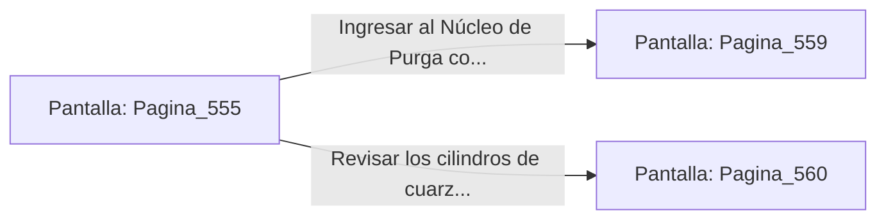

# 📺 Nodo Pantalla: `Pagina_555`

[[Index|⬅️ Índice]] | Fichero Origen: [[sample_eligejuego-code_capitulo_29_mpl|📄 sample/eligejuego-code/capitulo_29.mpl]]

**Narrativa y Encabezado:**
> PÁGINA 555: FUEGO PRECISO EN LOS FILTROS
> 
> Alineas la mira del Rifle Cronal y descargas dos ráfagas de aceleración concisa contra las juntas de las guadañas. Los proyectiles provocan la detonación de los núcleos de fase, desintegrando a los dos ejecutores en una cortina de chispas verdes.
> 
> Con el camino libre, alcanzas el descansillo del fondo donde hallas un nicho blindado con dos Células de Éter Sobrecargadas y la Tarjeta de Acceso al Núcleo de Purga.
> 
> Sincronizas los componentes en tu arnés táctico antes de dirigirte a la entrada del Núcleo de Purga.

## 📋 Desglose de Instrucciones de Opciones
### `OPCION "Ingresar al Núcleo de Purga con la tarjeta de acceso" CON_ACCION TRANSICIONAR_A Pagina_559`
* **Instrucción:** `OPCION` *(Manual: Mapea una entrada o botón interactivo de usuario. Vincular una acción como la invocación de una función C1, un método C2 o una transición C3.)*
* **Efecto de Control:** Dispara `TRANSICIONAR_A` hacia [[Pantalla_Pagina_559|📺 Pagina_559]]
### `OPCION "Revisar los cilindros de cuarzo del descansillo" CON_ACCION TRANSICIONAR_A Pagina_560`
* **Instrucción:** `OPCION` *(Manual: Mapea una entrada o botón interactivo de usuario. Vincular una acción como la invocación de una función C1, un método C2 o una transición C3.)*
* **Efecto de Control:** Dispara `TRANSICIONAR_A` hacia [[Pantalla_Pagina_560|📺 Pagina_560]]

## 📊 Diagrama de Flujo e Interacción (Mermaid)

