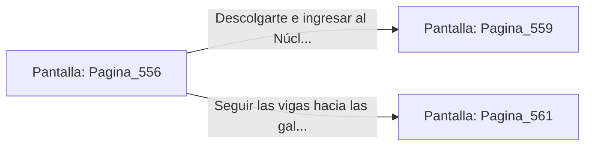

# 📺 Nodo Pantalla: `Pagina_556`

[[Index|⬅️ Índice]] | Fichero Origen: [[sample_eligejuego-code_capitulo_29_mpl|📄 sample/eligejuego-code/capitulo_29.mpl]]

**Narrativa y Encabezado:**
> PÁGINA 556: EVASIÓN POR LA VIGA SUPERIOR
> 
> Disparas el gancho de agarre y te elevas hacia la viga de obsidiana del techo, superando la zona de patrulla de los ejecutores. Avanzas con agilidad por la estructura metálica.
> 
> Te descuelgas limpiamente al otro lado de la pasarela frente al portón del Núcleo de Purga.

## 📋 Desglose de Instrucciones de Opciones
### `OPCION "Descolgarte e ingresar al Núcleo de Purga" CON_ACCION TRANSICIONAR_A Pagina_559`
* **Instrucción:** `OPCION` *(Manual: Mapea una entrada o botón interactivo de usuario. Vincular una acción como la invocación de una función C1, un método C2 o una transición C3.)*
* **Efecto de Control:** Dispara `TRANSICIONAR_A` hacia [[Pantalla_Pagina_559|📺 Pagina_559]]
### `OPCION "Seguir las vigas hacia las galerías de filtrado" CON_ACCION TRANSICIONAR_A Pagina_561`
* **Instrucción:** `OPCION` *(Manual: Mapea una entrada o botón interactivo de usuario. Vincular una acción como la invocación de una función C1, un método C2 o una transición C3.)*
* **Efecto de Control:** Dispara `TRANSICIONAR_A` hacia [[Pantalla_Pagina_561|📺 Pagina_561]]

## 📊 Diagrama de Flujo e Interacción (Mermaid)

