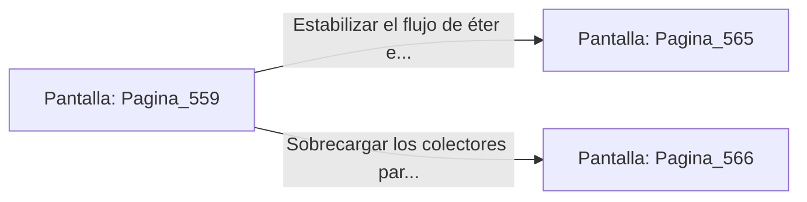

# 📺 Nodo Pantalla: `Pagina_559`

[[Index|⬅️ Índice]] | Fichero Origen: [[sample_eligejuego-code_capitulo_29_mpl|📄 sample/eligejuego-code/capitulo_29.mpl]]

**Narrativa y Encabezado:**
> PÁGINA 559: EL NÚCLEO DE PURGA
> 
> Deslizas la tarjeta de acceso por el lector rúnico e ingresas al imponente Núcleo de Purga. Una columna de luz esmeralda pura gira a revoluciones vertiginosas en el centro de la nave, canalizando la energía lista para el ensamblaje final de la realidad.
> 
> En la consola principal brilla la Tarjeta de Nivel Doce —la última tarjeta de seguridad del complejo— y un conmutador que permite estabilizar el flujo o sobrecargar los colectores.
> 
> Sincronizas la Tarjeta de Nivel Doce en tu Brazal de Convergencia antes de tomar una decisión en la consola.

## 📋 Desglose de Instrucciones de Opciones
### `OPCION "Estabilizar el flujo de éter esmeralda en la consola central" CON_ACCION TRANSICIONAR_A Pagina_565`
* **Instrucción:** `OPCION` *(Manual: Mapea una entrada o botón interactivo de usuario. Vincular una acción como la invocación de una función C1, un método C2 o una transición C3.)*
* **Efecto de Control:** Dispara `TRANSICIONAR_A` hacia [[Pantalla_Pagina_565|📺 Pagina_565]]
### `OPCION "Sobrecargar los colectores para inutilizar la guardia del sector" CON_ACCION TRANSICIONAR_A Pagina_566`
* **Instrucción:** `OPCION` *(Manual: Mapea una entrada o botón interactivo de usuario. Vincular una acción como la invocación de una función C1, un método C2 o una transición C3.)*
* **Efecto de Control:** Dispara `TRANSICIONAR_A` hacia [[Pantalla_Pagina_566|📺 Pagina_566]]

## 📊 Diagrama de Flujo e Interacción (Mermaid)

