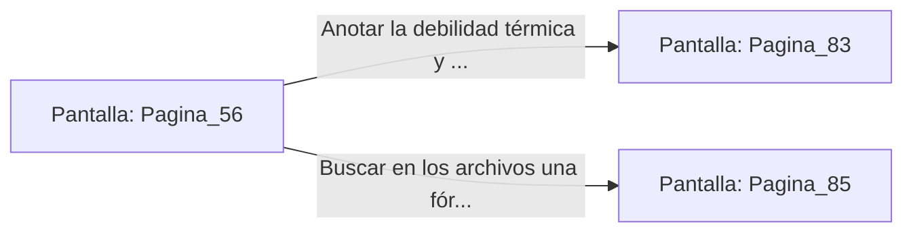

# 📺 Nodo Pantalla: `Pagina_56`

[[Index|⬅️ Índice]] | Fichero Origen: [[sample_eligejuego-code_capitulo_04_mpl|📄 sample/eligejuego-code/capitulo_04.mpl]]

**Narrativa y Encabezado:**
> PÁGINA 56: EL EXPEDIENTE DE MALAKOR
> 
> Los archivos mnemónicos revelan una verdad trágica: Malakor no siempre fue un tirano. Antaño fue el Primer Archimago de Aethelgard, pero la corrupción del Cronoclave quebró su juicio, atándolo eternamente al Núcleo de Éter.
> 
> El informe destaca que su armadura de fase tiene un punto ciego térmico en el hombro izquierdo, secuela de una antigua herida de guerra.

## 📋 Desglose de Instrucciones de Opciones
### `OPCION "Anotar la debilidad térmica y poner rumbo a la Fosa de los Juramentos" CON_ACCION TRANSICIONAR_A Pagina_83`
* **Instrucción:** `OPCION` *(Manual: Mapea una entrada o botón interactivo de usuario. Vincular una acción como la invocación de una función C1, un método C2 o una transición C3.)*
* **Efecto de Control:** Dispara `TRANSICIONAR_A` hacia [[Pantalla_Pagina_83|📺 Pagina_83]]
### `OPCION "Buscar en los archivos una fórmula para purificar su alma" CON_ACCION TRANSICIONAR_A Pagina_85`
* **Instrucción:** `OPCION` *(Manual: Mapea una entrada o botón interactivo de usuario. Vincular una acción como la invocación de una función C1, un método C2 o una transición C3.)*
* **Efecto de Control:** Dispara `TRANSICIONAR_A` hacia [[Pantalla_Pagina_85|📺 Pagina_85]]

## 📊 Diagrama de Flujo e Interacción (Mermaid)

