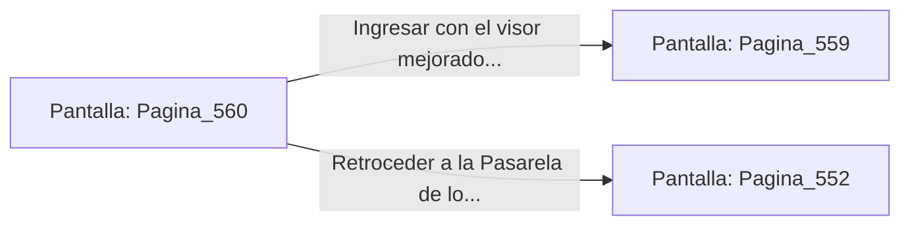

# 📺 Nodo Pantalla: `Pagina_560`

[[Index|⬅️ Índice]] | Fichero Origen: [[sample_eligejuego-code_capitulo_29_mpl|📄 sample/eligejuego-code/capitulo_29.mpl]]

**Narrativa y Encabezado:**
> PÁGINA 560: REVISIÓN DE CILINDROS DE CUARZO
> 
> Examinas los cilindros de cuarzo del descansillo y recuperas un cristal de enfoque térmico que adosas al visor de tu casco.
> 
> Con la mejora integrada, ingresas con la tarjeta al Núcleo de Purga.

## 📋 Desglose de Instrucciones de Opciones
### `OPCION "Ingresar con el visor mejorado al Núcleo de Purga" CON_ACCION TRANSICIONAR_A Pagina_559`
* **Instrucción:** `OPCION` *(Manual: Mapea una entrada o botón interactivo de usuario. Vincular una acción como la invocación de una función C1, un método C2 o una transición C3.)*
* **Efecto de Control:** Dispara `TRANSICIONAR_A` hacia [[Pantalla_Pagina_559|📺 Pagina_559]]
### `OPCION "Retroceder a la Pasarela de los Filtros" CON_ACCION TRANSICIONAR_A Pagina_552`
* **Instrucción:** `OPCION` *(Manual: Mapea una entrada o botón interactivo de usuario. Vincular una acción como la invocación de una función C1, un método C2 o una transición C3.)*
* **Efecto de Control:** Dispara `TRANSICIONAR_A` hacia [[Pantalla_Pagina_552|📺 Pagina_552]]

## 📊 Diagrama de Flujo e Interacción (Mermaid)

