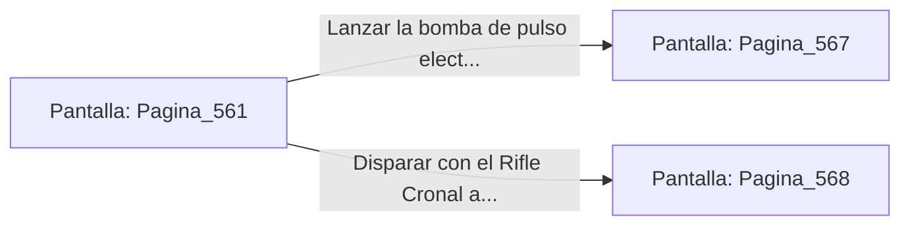

# 📺 Nodo Pantalla: `Pagina_561`

[[Index|⬅️ Índice]] | Fichero Origen: [[sample_eligejuego-code_capitulo_29_mpl|📄 sample/eligejuego-code/capitulo_29.mpl]]

**Narrativa y Encabezado:**
> PÁGINA 561: LAS GALERÍAS DE FILTRADO
> 
> Te descuelgas a las Galerías de Filtrado de la Purga. Enormes tanques de purificación de éter filtran las impurezas mnemónicas antes de alimentar el motor central de Aethelgard.
> 
> Un autómata pesado de combate de la Vieja Guardia custodia la consola de la galería esgrimiendo una maza térmico-eléctrica. La máquina detecta tu presencia e inicia el ataque.
> 
> Puedes usar la bomba de pulso electromagnético para anular sus circuitos o disparar con tu Rifle Cronal a los tubos de su maza.

## 📋 Desglose de Instrucciones de Opciones
### `OPCION "Lanzar la bomba de pulso electromagnético contra el autómata" CON_ACCION TRANSICIONAR_A Pagina_567`
* **Instrucción:** `OPCION` *(Manual: Mapea una entrada o botón interactivo de usuario. Vincular una acción como la invocación de una función C1, un método C2 o una transición C3.)*
* **Efecto de Control:** Dispara `TRANSICIONAR_A` hacia [[Pantalla_Pagina_567|📺 Pagina_567]]
### `OPCION "Disparar con el Rifle Cronal a los tubos de su maza" CON_ACCION TRANSICIONAR_A Pagina_568`
* **Instrucción:** `OPCION` *(Manual: Mapea una entrada o botón interactivo de usuario. Vincular una acción como la invocación de una función C1, un método C2 o una transición C3.)*
* **Efecto de Control:** Dispara `TRANSICIONAR_A` hacia [[Pantalla_Pagina_568|📺 Pagina_568]]

## 📊 Diagrama de Flujo e Interacción (Mermaid)

