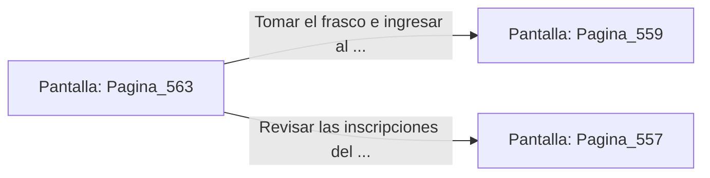

# 📺 Nodo Pantalla: `Pagina_563`

[[Index|⬅️ Índice]] | Fichero Origen: [[sample_eligejuego-code_capitulo_29_mpl|📄 sample/eligejuego-code/capitulo_29.mpl]]

**Narrativa y Encabezado:**
> PÁGINA 563: LA CÁMARA DE LA PURGA FINAL
> 
> Ingresas a la Cámara de la Purga Final. En el centro de la estancia, sobre un altar de mármol negro, flota el Sello del Núcleo Maestro emitido con la frecuencia pura de Aethelgard.
> 
> En la peana reposa un frasco de Éter Puro Concentrado y la Clave de Acceso al Capítulo 30, la última etapa de la aventura.
> 
> Te apoderas del frasco y sincronizas la clave en tu Brazal antes de avanzar al Núcleo de Purga.

## 📋 Desglose de Instrucciones de Opciones
### `OPCION "Tomar el frasco e ingresar al Núcleo de Purga" CON_ACCION TRANSICIONAR_A Pagina_559`
* **Instrucción:** `OPCION` *(Manual: Mapea una entrada o botón interactivo de usuario. Vincular una acción como la invocación de una función C1, un método C2 o una transición C3.)*
* **Efecto de Control:** Dispara `TRANSICIONAR_A` hacia [[Pantalla_Pagina_559|📺 Pagina_559]]
### `OPCION "Revisar las inscripciones del altar de mármol" CON_ACCION TRANSICIONAR_A Pagina_557`
* **Instrucción:** `OPCION` *(Manual: Mapea una entrada o botón interactivo de usuario. Vincular una acción como la invocación de una función C1, un método C2 o una transición C3.)*
* **Efecto de Control:** Dispara `TRANSICIONAR_A` hacia [[Pantalla_Pagina_557|📺 Pagina_557]]

## 📊 Diagrama de Flujo e Interacción (Mermaid)

