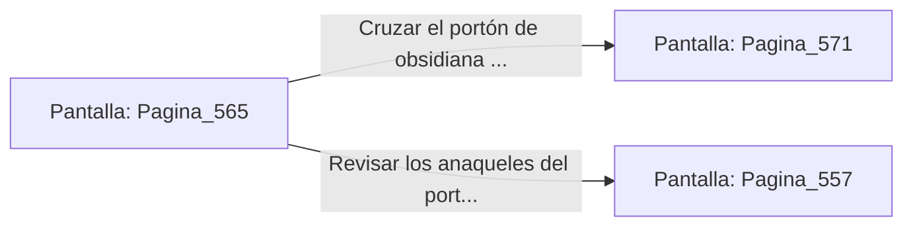

# 📺 Nodo Pantalla: `Pagina_565`

[[Index|⬅️ Índice]] | Fichero Origen: [[sample_eligejuego-code_capitulo_29_mpl|📄 sample/eligejuego-code/capitulo_29.mpl]]

**Narrativa y Encabezado:**
> PÁGINA 565: EL PASO HACIA EL CAPÍTULO 30
> 
> Con la Tarjeta de Nivel Doce autenticada y la columna de éter esmeralda estabilizada en parámetros perfectos, el colosal portón acorazado de obsidiana del extremo norte se abre de par en par.
> 
> Ante ti se despliega la majestuosa calzada iluminada por luz dorada que conduce hacia las Cámaras del Capítulo 30, el clímax definitivo donde aguarda el Gran Núcleo Maestro de Aethelgard.
> 
> Verificas el estado de tus armas, restauras tus escudos y ajustas las correas de tu armadura antes de cruzar el umbral decisivo.

## 📋 Desglose de Instrucciones de Opciones
### `OPCION "Cruzar el portón de obsidiana e ingresar al Capítulo 30 (El Clímax)" CON_ACCION TRANSICIONAR_A Pagina_571`
* **Instrucción:** `OPCION` *(Manual: Mapea una entrada o botón interactivo de usuario. Vincular una acción como la invocación de una función C1, un método C2 o una transición C3.)*
* **Efecto de Control:** Dispara `TRANSICIONAR_A` hacia [[Pantalla_Pagina_571|📺 Pagina_571]]
### `OPCION "Revisar los anaqueles del portón en busca de suministros de última hora" CON_ACCION TRANSICIONAR_A Pagina_557`
* **Instrucción:** `OPCION` *(Manual: Mapea una entrada o botón interactivo de usuario. Vincular una acción como la invocación de una función C1, un método C2 o una transición C3.)*
* **Efecto de Control:** Dispara `TRANSICIONAR_A` hacia [[Pantalla_Pagina_557|📺 Pagina_557]]

## 📊 Diagrama de Flujo e Interacción (Mermaid)

