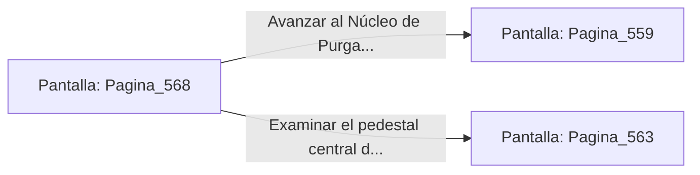

# 📺 Nodo Pantalla: `Pagina_568`

[[Index|⬅️ Índice]] | Fichero Origen: [[sample_eligejuego-code_capitulo_29_mpl|📄 sample/eligejuego-code/capitulo_29.mpl]]

**Narrativa y Encabezado:**
> PÁGINA 568: IMPACTO EN LA MAZA TÉRMICA
> 
> Descargas una ráfaga con el Rifle Cronal directamente en las conducciones de la maza del autómata. La sobrecarga provoca la detonación de la unidad, haciéndola desplomarse.
> 
> Con la sala despejada, recoges las células de energía y te encaminas a la salida.

## 📋 Desglose de Instrucciones de Opciones
### `OPCION "Avanzar al Núcleo de Purga" CON_ACCION TRANSICIONAR_A Pagina_559`
* **Instrucción:** `OPCION` *(Manual: Mapea una entrada o botón interactivo de usuario. Vincular una acción como la invocación de una función C1, un método C2 o una transición C3.)*
* **Efecto de Control:** Dispara `TRANSICIONAR_A` hacia [[Pantalla_Pagina_559|📺 Pagina_559]]
### `OPCION "Examinar el pedestal central de la galería" CON_ACCION TRANSICIONAR_A Pagina_563`
* **Instrucción:** `OPCION` *(Manual: Mapea una entrada o botón interactivo de usuario. Vincular una acción como la invocación de una función C1, un método C2 o una transición C3.)*
* **Efecto de Control:** Dispara `TRANSICIONAR_A` hacia [[Pantalla_Pagina_563|📺 Pagina_563]]

## 📊 Diagrama de Flujo e Interacción (Mermaid)

