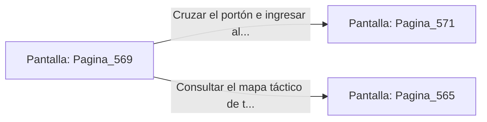

# 📺 Nodo Pantalla: `Pagina_569`

[[Index|⬅️ Índice]] | Fichero Origen: [[sample_eligejuego-code_capitulo_29_mpl|📄 sample/eligejuego-code/capitulo_29.mpl]]

**Narrativa y Encabezado:**
> PÁGINA 569: EL TRIUNFO EN LAS BÓVEDAS DE PURGA
> 
> Atraviesas las naves purificadas de las Bóvedas de la Gran Purga portando la Tarjeta de Nivel Doce y tu equipo al máximo rendimiento. La luz de la columna esmeralda brilla con un tono dorado cálido y pacífico.
> 
> Tu Brazal de Convergencia confirma que las Cámaras 551 a 570 han sido estabilizadas con éxito dentro de la red del complejo.
> 
> Te detienes frente al portón del Capítulo 30 con la firmeza del héroe listo para encarar la batalla final por Aethelgard.

## 📋 Desglose de Instrucciones de Opciones
### `OPCION "Cruzar el portón e ingresar al Capítulo 30 (El Clímax)" CON_ACCION TRANSICIONAR_A Pagina_571`
* **Instrucción:** `OPCION` *(Manual: Mapea una entrada o botón interactivo de usuario. Vincular una acción como la invocación de una función C1, un método C2 o una transición C3.)*
* **Efecto de Control:** Dispara `TRANSICIONAR_A` hacia [[Pantalla_Pagina_571|📺 Pagina_571]]
### `OPCION "Consultar el mapa táctico de tu Brazal" CON_ACCION TRANSICIONAR_A Pagina_565`
* **Instrucción:** `OPCION` *(Manual: Mapea una entrada o botón interactivo de usuario. Vincular una acción como la invocación de una función C1, un método C2 o una transición C3.)*
* **Efecto de Control:** Dispara `TRANSICIONAR_A` hacia [[Pantalla_Pagina_565|📺 Pagina_565]]

## 📊 Diagrama de Flujo e Interacción (Mermaid)

