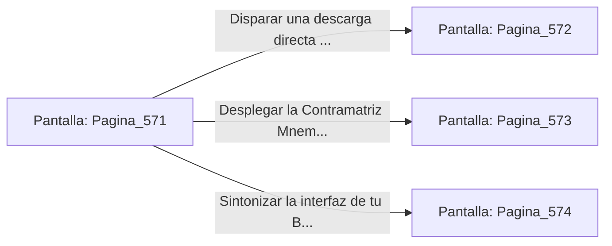

# 📺 Nodo Pantalla: `Pagina_571`

[[Index|⬅️ Índice]] | Fichero Origen: [[sample_eligejuego-code_capitulo_30_mpl|📄 sample/eligejuego-code/capitulo_30.mpl]]

**Narrativa y Encabezado:**
> PÁGINA 571: EL CÚMNIS DE LA CONVERGENCIA
> 
> Cruzas el portón de obsidiana y pones pie en la imponente plataforma central del Gran Núcleo Maestro de Aethelgard. Suspendido sobre el abismo de la realidad, un inmenso entramado de cristal de cuarzo y titanio gira en torno a un reactor de plasma estelar que ilumina la bóveda del cielo subterráneo con destellos dorados y esmeraldas.
> 
> Tu Brazal de Convergencia vibra a su máxima frecuencia: la totalidad de los datos de las 570 cámaras recorre tus circuitos de interfaz, preparando la sincronización final del flujo cronal. Sin embargo, en el centro de la consola del Núcleo, la manifestación residual de la Sombra de la Entidad Primigenia intenta corromper el canal de la Purga Cronal.
> 
> Ante ti se despliegan tres opciones críticas para el enfrentamiento final: ejecutar la Purga Directa con el Rifle Cronal, desplegar la Contramatriz Mnemónica o sintonizar tu Brazal a la frecuencia de resonancia del Núcleo.

## 📋 Desglose de Instrucciones de Opciones
### `OPCION "Disparar una descarga directa de aceleración con el Rifle Cronal" CON_ACCION TRANSICIONAR_A Pagina_572`
* **Instrucción:** `OPCION` *(Manual: Mapea una entrada o botón interactivo de usuario. Vincular una acción como la invocación de una función C1, un método C2 o una transición C3.)*
* **Efecto de Control:** Dispara `TRANSICIONAR_A` hacia [[Pantalla_Pagina_572|📺 Pagina_572]]
### `OPCION "Desplegar la Contramatriz Mnemónica mediante tu Brazal de Convergencia" CON_ACCION TRANSICIONAR_A Pagina_573`
* **Instrucción:** `OPCION` *(Manual: Mapea una entrada o botón interactivo de usuario. Vincular una acción como la invocación de una función C1, un método C2 o una transición C3.)*
* **Efecto de Control:** Dispara `TRANSICIONAR_A` hacia [[Pantalla_Pagina_573|📺 Pagina_573]]
### `OPCION "Sintonizar la interfaz de tu Brazal a la frecuencia de resonancia pura" CON_ACCION TRANSICIONAR_A Pagina_574`
* **Instrucción:** `OPCION` *(Manual: Mapea una entrada o botón interactivo de usuario. Vincular una acción como la invocación de una función C1, un método C2 o una transición C3.)*
* **Efecto de Control:** Dispara `TRANSICIONAR_A` hacia [[Pantalla_Pagina_574|📺 Pagina_574]]

## 📊 Diagrama de Flujo e Interacción (Mermaid)

