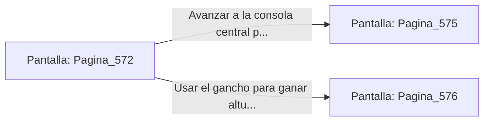

# 📺 Nodo Pantalla: `Pagina_572`

[[Index|⬅️ Índice]] | Fichero Origen: [[sample_eligejuego-code_capitulo_30_mpl|📄 sample/eligejuego-code/capitulo_30.mpl]]

**Narrativa y Encabezado:**
> PÁGINA 572: EL DISPARO DE ACELERACIÓN CRONAL
> 
> Alineas la mira de tu Rifle Cronal y descargas una ráfaga continua de energía acelerada contra el corazón de la Sombra Primigenia. Los proyectiles cortan la materia oscura de la entidad, agriando su cohesión astral y haciendo tambalear la barrera del reactor.
> 
> La Sombra lanza un rugido sordo que agrieta las losas de mármol de la plataforma antes de replegarse hacia los colectores laterales.

## 📋 Desglose de Instrucciones de Opciones
### `OPCION "Avanzar a la consola central para activar el Sellado Maestro" CON_ACCION TRANSICIONAR_A Pagina_575`
* **Instrucción:** `OPCION` *(Manual: Mapea una entrada o botón interactivo de usuario. Vincular una acción como la invocación de una función C1, un método C2 o una transición C3.)*
* **Efecto de Control:** Dispara `TRANSICIONAR_A` hacia [[Pantalla_Pagina_575|📺 Pagina_575]]
### `OPCION "Usar el gancho para ganar altura en las pasarelas del reactor" CON_ACCION TRANSICIONAR_A Pagina_576`
* **Instrucción:** `OPCION` *(Manual: Mapea una entrada o botón interactivo de usuario. Vincular una acción como la invocación de una función C1, un método C2 o una transición C3.)*
* **Efecto de Control:** Dispara `TRANSICIONAR_A` hacia [[Pantalla_Pagina_576|📺 Pagina_576]]

## 📊 Diagrama de Flujo e Interacción (Mermaid)

