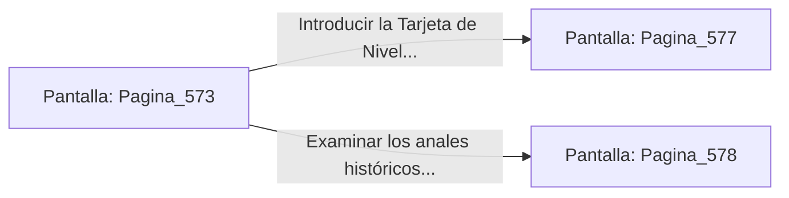

# 📺 Nodo Pantalla: `Pagina_573`

[[Index|⬅️ Índice]] | Fichero Origen: [[sample_eligejuego-code_capitulo_30_mpl|📄 sample/eligejuego-code/capitulo_30.mpl]]

**Narrativa y Encabezado:**
> PÁGINA 573: LA CONTRAMATRIZ MNEMÓNICA
> 
> Conectas tu Brazal de Convergencia a la toma de datos de la plataforma y proyectas la Contramatriz Mnemónica construida con los códigos de los treinta capítulos. Un pulso de luz dorada se expande en forma de onda expansiva circular, envolviendo la manifestación oscura.
> 
> La Sombra Primigenia se retuerce al contacto con las frecuencias puras de Aethelgard, quedando atrapada en un campo de contención magnética de alta densidad del que no puede liberarse.
> 
> Con la entidad neutralizada de forma definitiva, la consola del Núcleo Maestro queda totalmente libre a tu disposición.

## 📋 Desglose de Instrucciones de Opciones
### `OPCION "Introducir la Tarjeta de Nivel Doce y ejecutar el Sellado Definitivo" CON_ACCION TRANSICIONAR_A Pagina_577`
* **Instrucción:** `OPCION` *(Manual: Mapea una entrada o botón interactivo de usuario. Vincular una acción como la invocación de una función C1, un método C2 o una transición C3.)*
* **Efecto de Control:** Dispara `TRANSICIONAR_A` hacia [[Pantalla_Pagina_577|📺 Pagina_577]]
### `OPCION "Examinar los anales históricos finales en la pantalla de la consola" CON_ACCION TRANSICIONAR_A Pagina_578`
* **Instrucción:** `OPCION` *(Manual: Mapea una entrada o botón interactivo de usuario. Vincular una acción como la invocación de una función C1, un método C2 o una transición C3.)*
* **Efecto de Control:** Dispara `TRANSICIONAR_A` hacia [[Pantalla_Pagina_578|📺 Pagina_578]]

## 📊 Diagrama de Flujo e Interacción (Mermaid)

