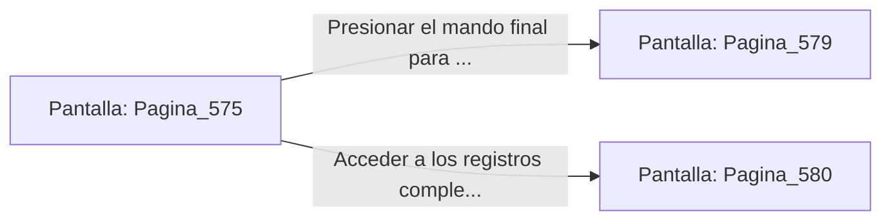

# 📺 Nodo Pantalla: `Pagina_575`

[[Index|⬅️ Índice]] | Fichero Origen: [[sample_eligejuego-code_capitulo_30_mpl|📄 sample/eligejuego-code/capitulo_30.mpl]]

**Narrativa y Encabezado:**
> PÁGINA 575: EL SELLADO MAESTRO EN PROCESO
> 
> Insertas la Tarjeta de Nivel Doce en el conector principal del Gran Núcleo Maestro. Las tres reliquias de fase en tu Brazal emiten un haz de luz dorada convergente que penetra en el centro del reactor de plasma.
> 
> Un tono armónico de pureza cristalina resuena en toda la estructura de Aethelgard. Las grietas espacio-temporales en cada una de las 600 Cámaras del complejo comienzan a sellarse en una reacción en cadena pacífica.
> 
> La pantalla de tu Brazal confirma que el noventa y nueve por ciento del proceso de estabilización se ha completado con éxito.

## 📋 Desglose de Instrucciones de Opciones
### `OPCION "Presionar el mando final para culminar el Sellado Definitivo" CON_ACCION TRANSICIONAR_A Pagina_579`
* **Instrucción:** `OPCION` *(Manual: Mapea una entrada o botón interactivo de usuario. Vincular una acción como la invocación de una función C1, un método C2 o una transición C3.)*
* **Efecto de Control:** Dispara `TRANSICIONAR_A` hacia [[Pantalla_Pagina_579|📺 Pagina_579]]
### `OPCION "Acceder a los registros completos de la expedición" CON_ACCION TRANSICIONAR_A Pagina_580`
* **Instrucción:** `OPCION` *(Manual: Mapea una entrada o botón interactivo de usuario. Vincular una acción como la invocación de una función C1, un método C2 o una transición C3.)*
* **Efecto de Control:** Dispara `TRANSICIONAR_A` hacia [[Pantalla_Pagina_580|📺 Pagina_580]]

## 📊 Diagrama de Flujo e Interacción (Mermaid)

