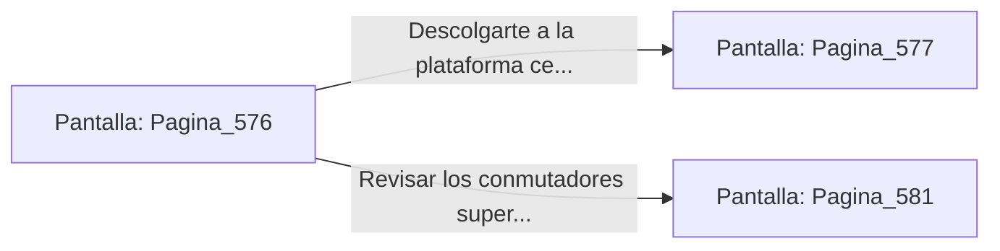

# 📺 Nodo Pantalla: `Pagina_576`

[[Index|⬅️ Índice]] | Fichero Origen: [[sample_eligejuego-code_capitulo_30_mpl|📄 sample/eligejuego-code/capitulo_30.mpl]]

**Narrativa y Encabezado:**
> PÁGINA 576: EL ATAQUE DESDE LAS PASARELAS
> 
> Ganando altura con el gancho de agarre, te encaramas a las pasarelas superiores sobre el reactor. Desde esta posición privilegiada descargas una bomba de pulso electromagnético directamente a la base de la Sombra.
> 
> La onda expansiva disipa los restos de la entidad y despeja la consola del Núcleo.

## 📋 Desglose de Instrucciones de Opciones
### `OPCION "Descolgarte a la plataforma central para accionar la consola" CON_ACCION TRANSICIONAR_A Pagina_577`
* **Instrucción:** `OPCION` *(Manual: Mapea una entrada o botón interactivo de usuario. Vincular una acción como la invocación de una función C1, un método C2 o una transición C3.)*
* **Efecto de Control:** Dispara `TRANSICIONAR_A` hacia [[Pantalla_Pagina_577|📺 Pagina_577]]
### `OPCION "Revisar los conmutadores superiores antes del descenso" CON_ACCION TRANSICIONAR_A Pagina_581`
* **Instrucción:** `OPCION` *(Manual: Mapea una entrada o botón interactivo de usuario. Vincular una acción como la invocación de una función C1, un método C2 o una transición C3.)*
* **Efecto de Control:** Dispara `TRANSICIONAR_A` hacia [[Pantalla_Pagina_581|📺 Pagina_581]]

## 📊 Diagrama de Flujo e Interacción (Mermaid)

