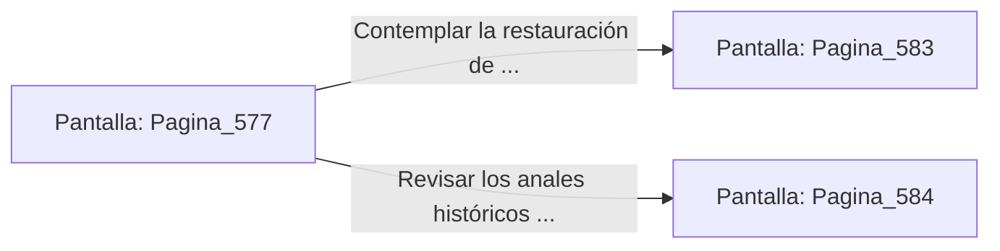

# 📺 Nodo Pantalla: `Pagina_577`

[[Index|⬅️ Índice]] | Fichero Origen: [[sample_eligejuego-code_capitulo_30_mpl|📄 sample/eligejuego-code/capitulo_30.mpl]]

**Narrativa y Encabezado:**
> PÁGINA 577: EL SELLADO DEFINITIVO DE AETHELGARD
> 
> Accionas el conmutador maestro de la consola del Núcleo. El reactor de plasma estelar emite un último destello de luz esmeralda y dorada que se propaga por las venas de titanio de toda la ciudadela subterránea.
> 
> El zumbido atronador del Cronoclave se disipa gradualmente, dando paso a un silencio pacífico y sereno. Las luces de emergencia se apagan y son reemplazadas por lámparas de cristal de luminiscencia continua.
> 
> Has triunfado. El Colapso de Mnemósine ha sido revertido, Malakor y las sombras han sido vencidos, y el futuro de las líneas temporales está a salvo para siempre.

## 📋 Desglose de Instrucciones de Opciones
### `OPCION "Contemplar la restauración de Aethelgard desde la plataforma del Núcleo" CON_ACCION TRANSICIONAR_A Pagina_583`
* **Instrucción:** `OPCION` *(Manual: Mapea una entrada o botón interactivo de usuario. Vincular una acción como la invocación de una función C1, un método C2 o una transición C3.)*
* **Efecto de Control:** Dispara `TRANSICIONAR_A` hacia [[Pantalla_Pagina_583|📺 Pagina_583]]
### `OPCION "Revisar los anales históricos finales grabados en tu Brazal" CON_ACCION TRANSICIONAR_A Pagina_584`
* **Instrucción:** `OPCION` *(Manual: Mapea una entrada o botón interactivo de usuario. Vincular una acción como la invocación de una función C1, un método C2 o una transición C3.)*
* **Efecto de Control:** Dispara `TRANSICIONAR_A` hacia [[Pantalla_Pagina_584|📺 Pagina_584]]

## 📊 Diagrama de Flujo e Interacción (Mermaid)

