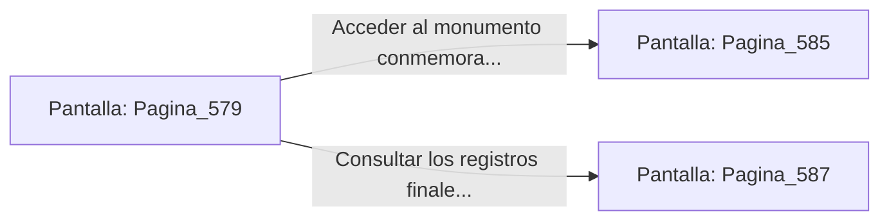

# 📺 Nodo Pantalla: `Pagina_579`

[[Index|⬅️ Índice]] | Fichero Origen: [[sample_eligejuego-code_capitulo_30_mpl|📄 sample/eligejuego-code/capitulo_30.mpl]]

**Narrativa y Encabezado:**
> PÁGINA 579: LA RESTAURACIÓN DE LAS 600 CÁMARAS
> 
> La pantalla holográfica del Núcleo desglosa el informe de estado de la red: desde la Cámara 1 hasta la Cámara 600, las firmas de radiación se encuentran en valores nominales perfectos.
> 
> Los autómatas de la guardia entran en modo de conservación pacífica, los canales de refrigeración fluyen limpios y el tiempo recupera su curso lineal en todo el imperio.
> 
> Tu memoria óptica guarda el registro completo de tu hazaña como el Gran Arquitecto de la Convergencia.

## 📋 Desglose de Instrucciones de Opciones
### `OPCION "Acceder al monumento conmemorativo de Aethelgard" CON_ACCION TRANSICIONAR_A Pagina_585`
* **Instrucción:** `OPCION` *(Manual: Mapea una entrada o botón interactivo de usuario. Vincular una acción como la invocación de una función C1, un método C2 o una transición C3.)*
* **Efecto de Control:** Dispara `TRANSICIONAR_A` hacia [[Pantalla_Pagina_585|📺 Pagina_585]]
### `OPCION "Consultar los registros finales de la hazaña" CON_ACCION TRANSICIONAR_A Pagina_587`
* **Instrucción:** `OPCION` *(Manual: Mapea una entrada o botón interactivo de usuario. Vincular una acción como la invocación de una función C1, un método C2 o una transición C3.)*
* **Efecto de Control:** Dispara `TRANSICIONAR_A` hacia [[Pantalla_Pagina_587|📺 Pagina_587]]

## 📊 Diagrama de Flujo e Interacción (Mermaid)

