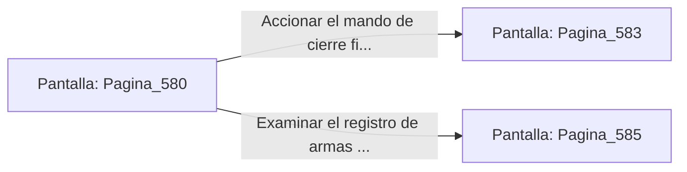

# 📺 Nodo Pantalla: `Pagina_580`

[[Index|⬅️ Índice]] | Fichero Origen: [[sample_eligejuego-code_capitulo_30_mpl|📄 sample/eligejuego-code/capitulo_30.mpl]]

**Narrativa y Encabezado:**
> PÁGINA 580: LOS ARCHIVOS DE LA EXPEDICIÓN
> 
> Tu Brazal de Convergencia descarga los anales de la expedición: cada capítulo, cada batalla y cada elección acertada quedan documentadas en la base de datos central.
> 
> Con la información preservada, procedes al cierre final de la consola.

## 📋 Desglose de Instrucciones de Opciones
### `OPCION "Accionar el mando de cierre final y contemplar la victoria" CON_ACCION TRANSICIONAR_A Pagina_583`
* **Instrucción:** `OPCION` *(Manual: Mapea una entrada o botón interactivo de usuario. Vincular una acción como la invocación de una función C1, un método C2 o una transición C3.)*
* **Efecto de Control:** Dispara `TRANSICIONAR_A` hacia [[Pantalla_Pagina_583|📺 Pagina_583]]
### `OPCION "Examinar el registro de armas y reliquias" CON_ACCION TRANSICIONAR_A Pagina_585`
* **Instrucción:** `OPCION` *(Manual: Mapea una entrada o botón interactivo de usuario. Vincular una acción como la invocación de una función C1, un método C2 o una transición C3.)*
* **Efecto de Control:** Dispara `TRANSICIONAR_A` hacia [[Pantalla_Pagina_585|📺 Pagina_585]]

## 📊 Diagrama de Flujo e Interacción (Mermaid)

